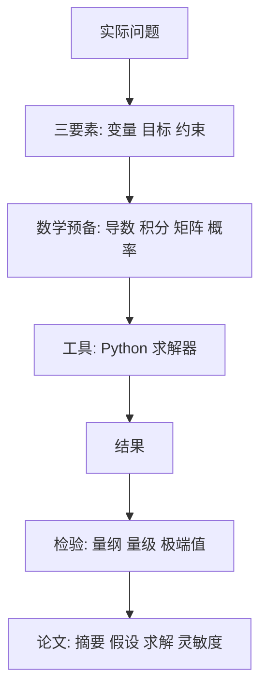

# 零基础起步 · 点化学习系统

## 这一册在讲什么

四本书里的算法都建立在一套共同的动作上：把实际问题翻成式子，算出来，再把结果翻回人话。这一册只讲这套动作，不碰任何具体算法。学完它再去读第 01 册，每章开头那些「设某工厂生产……」的例题就不会看着眼生。

## 全书心智模型

## 学习路径（推荐顺序）

| 步骤 | 章节 | 主题 | 前置 | 检查点 |
|---|---|---|---|---|
| 01 | ch01 | 建模在做什么 | 无 | 能用自己的话讲五步流程 |
| 02 | ch02 | 够用的数学预备 | ch01 | 能判断问题属于变化/累积/线性/随机哪一类 |
| 03 | ch03 | 计算工具与求解器 | ch02 | 能跑通 linprog 例子并核对 26 |
| 04 | ch04 | 论文的骨架 | ch01 | 能把一段空话摘要改出数字 |
| 05 | ch05 | 72 小时作战流程 | ch04 | 能排出自己队的三人时间表 |

## 章节索引

- 第 1 章 建模到底在做什么（★☆☆）→ chapters/ch01-what-is-modeling.md
- 第 2 章 够用的数学预备（★☆☆）→ chapters/ch02-math-prep.md
- 第 3 章 计算工具与求解器（★☆☆）→ chapters/ch03-tools.md
- 第 4 章 论文的骨架（★★☆）→ chapters/ch04-paper-skeleton.md
- 第 5 章 72 小时作战流程（★☆☆）→ chapters/ch05-72h-workflow.md

## 前置知识（零基础缺口补讲）

| 缺口 | 对应补讲位置 | 学完标志 |
|---|---|---|
| 不知道建模和数学题的区别 | 第 1 章 | 能说出为什么建模题没有标准答案 |
| 只学过高数线代，不知道建模用哪部分 | 第 2 章 | 能把四个概念各配一个建模场景 |
| 没写过求解代码 | 第 3 章 | 能独立跑通 linprog 并读 status |
| 没写过数模论文 | 第 4 章 | 能写出带数字的四段式摘要 |

## 术语表 / 模式库 / 速查表 入口

- 术语：glossary.md
- 模式库：patterns.md
- 速查表：cheatsheet.md
- 抽认卡：flashcards.md
