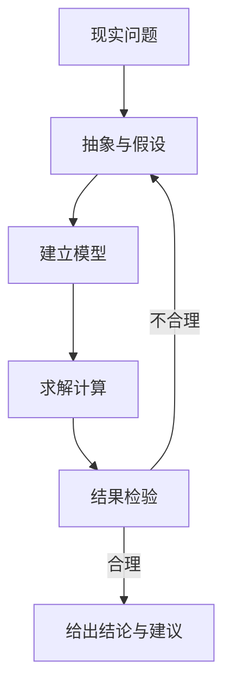

# 第 1 章：数学建模到底在做什么

- **难度**：★☆☆ | **预估学时**：1.5 小时 | **前置**：无

## 学习目标

学完本章，你能：

- 用「三要素」说清一个实际问题该建什么模型；
- 自己独立走完「问题 → 假设 → 模型 → 求解 → 检验」五步，并说出每步最容易错的地方；
- 分清数学题和建模题，知道为什么后者没有标准答案。

## 一句话核心

建模是把一句人话问题翻译成一组带字母的式子，再用算出来的数字反过来回答那句人话。

## 零基础讲解

### 概念 1：数学模型（难度：基础）

**数学模型**：用数学符号描述现实对象的一部分关系。它不是现实本身，是一张简化过的地图。

地图和地面的关系，就是模型和现实的关系：地图有用，恰恰因为它不全。一张 1:1 的地图没人看得懂。建模的第一件手艺，是决定哪些细节丢掉。

这个类比有个失效边界：地图的简化是空间上的，模型的简化可能丢掉的是因果关系。地面上的近路地图上看不出来，模型里漏掉的一个变量也可能让结论全错。

### 概念 2：三要素（难度：基础）

任何一个模型都能拆成三块：

1. **决策变量**：你能拍板的东西，用字母表示。比如每天生产甲机床 x₁ 台、乙机床 x₂ 台。
2. **目标函数**：你想要的结果，写成变量的表达式。比如利润 z = 4x₁ + 3x₂，单位千元。
3. **约束条件**：你不能越过的边界，写成含变量的等式或不等式。比如 A 机器每天只有 10 小时，2x₁ + x₂ ≤ 10。

三块凑齐，模型才闭合。缺目标函数，你不知道往哪优化；缺约束，答案会跑到无穷大；缺变量的正负范围，会算出「生产 −3 台机床」。

### 概念 3：五步流程（难度：基础）

1. **提出问题**：把口语问题改写成「在什么条件下，让什么量达到什么」。
2. **做出假设**：明确写下你忽略了什么。假设不是免责声明，它决定了模型能用到哪。
3. **建立模型**：定变量、写目标、列约束。
4. **求解**：手算小例子，或用程序算大例子。
5. **检验**：拿结果回到现实，看它荒不荒谬。

这五步不是一个方向走到底的流水线。检验发现结果荒唐，要退回第 2 步改假设。建模的时间，大半花在这条回路上。

### 概念 4：检验的三把尺（难度：基础）

- **量纲**：等号两边单位必须一样。算出「利润 26 小时」，一定错了。
- **量级**：结果要落在常识范围内。算出某城市一年用水 3 亿吨，先查这个城市多少人。
- **极端值**：把变量推到边界看公式还合不合理。产量为 0 时利润该是 0，如果你算出负数固定成本以外的怪值，说明假设漏了项。

## 图示

看图说明：注意只有一条回头箭头。真实建模里，回头可能发生在任意两步：求解失败要回模型，数据不够要回假设。图里画成一条，是为了让你记住检验不是走过场，它可以推翻前面所有工作。

## 类比与实例

- **类比**：建模像给陌生人画路线图。你不能把每条小巷都画上，要问对方「你骑车还是开车」，再决定画哪几条路。类比失效处：路线图不会骗人，模型会因为假设错误给出看似精确的错答案。
- **实例（可自己核算）**：估算一间长 12 米、宽 8 米的教室能坐多少人。面积 96 平方米。设每人座位加桌面占 1.2 平方米，走道与讲台占掉三成面积，可用面积 96 × 0.7 = 67.2 平方米，人数 67.2 ÷ 1.2 = 56 人。若改成报告厅式连排座，每人 0.6 平方米，则 112 人。同一个房间，换个假设，答案差一倍——这就是假设的份量。

## 常见误解

- 别以为建模就是套公式——实际上公式是最后一步。前面决定「算什么问题」的功夫，占七成时间，也决定成败。
- 别以为模型越复杂越高分——实际上评委先看模型能不能解释现象。加进十个变量却说不清哪个在起作用，比三个变量讲透更差。
- 别以为算出的数就是答案——实际上答案要翻译成人话：「建议每天生产甲 2 台、乙 6 台，日利润 2.6 万元」。只丢一个 26 上去，等于没回答。

## 自测题（答案与解析）

### Q1 【单选】下列哪一项不属于数学模型的三要素？
- A. 决策变量
- B. 目标函数
- C. 计算软件
- D. 约束条件
**答案**：C
**解析**：软件只是求解工具，换成手算或别的语言，模型本身不变。三要素是变量、目标、约束。

### Q2 【单选】某模型算出「每天利润 26 小时」，最先应该怀疑的是？
- A. 求解程序写错了
- B. 目标函数的量纲搞错了
- C. 约束条件太少
- D. 数据年份太旧
**答案**：B
**解析**：利润的单位不可能是小时。单位对不上，说明目标函数把某个量当成了别的东西，这是量纲检验的典型信号。

### Q3 【填空】建模流程中，检验发现结果与现实不符时，应当退回的步骤是________。
**答案**：假设（或模型建立）
**解析**：结果荒谬通常源于假设脱离现实，比如把「机器每天可用 10 小时」写成「每台机器 10 小时」。退回改假设，比在错误假设上硬调参数有效。

## 复习锚点

- 模型是简化过的地图，有用是因为它不全。
- 变量、目标、约束三块缺一块，模型就不闭合。
- 检验看三样：量纲、量级、极端值。
