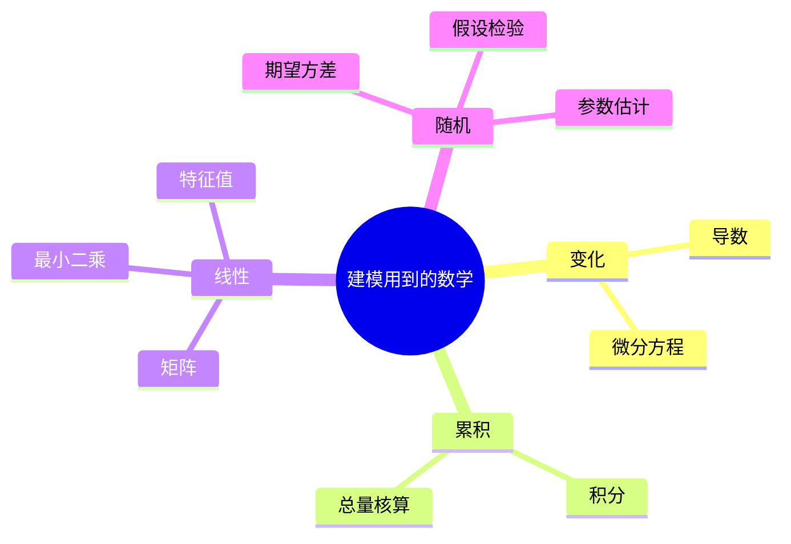

# 第 2 章：够用的数学预备

- **难度**：★☆☆ | **预估学时**：3 小时 | **前置**：第 1 章

## 学习目标

学完本章，你能：

- 说出导数、积分、矩阵、特征值、期望、方差在建模里各自负责什么；
- 遇到一个新问题，判断它大概归到「变化率」「累积」「线性关系」「随机性」哪一类；
- 不再因为看不懂某个算法里的符号而卡住，知道该补哪一块。

## 一句话核心

建模用到的数学只有四件事：算变化、算累积、解线性关系、处理不确定性。后面十几章的算法，都是这四件事的组合。

## 零基础讲解

### 概念 1：导数——变化有多快（难度：基础）

**导数**：函数在某一点的瞬时变化率。位移对时间求导是速度，速度再求导是加速度。

建模里它出现的地方很固定：只要题目里有「增长率」「传播速度」「边际成本」「温度下降快慢」，模型里就有导数，通常是微分方程。

一个必须记住的结论：函数在极值点处导数为零。所以求最优解时，先让导数为零，再判断是最大还是最小。第 3 章非线性规划的全部理论，都从这句话长出来。

类比：导数像汽车仪表盘上的瞬时车速。里程表显示的是总路程，看不出你此刻多快。失效边界：仪表盘永远有个读数，而有些函数在某些点根本不可导，比如绝对值函数在 0 点。

### 概念 2：积分——累积成总量（难度：基础）

**定积分**：把连续变化的东西一点点累加起来。已知流入速度求总水量，已知人口出生率求总人口增量，都是积分。

建模里的用法：微分方程解出来常带积分；概率里求区间概率也是对密度函数积分。

它和导数是反操作。记住了这个互逆关系，看到「已知速率求总量」就不慌。

### 概念 3：矩阵与线性方程组（难度：基础）

**矩阵**：把一堆数按行列排好。它在建模里干三件事：表示线性方程组、表示变换、存数据。

- 线性方程组 Ax = b：n 个未知数 n 个方程，解唯一当且仅当系数矩阵可逆。判断可逆看行列式是否为零。
- 最小二乘：方程数多于未知数时无精确解，转而求使 ‖Ax − b‖ 最小的 x。第 5 章拟合、第 7 章回归都用它。
- 特征值：矩阵 A 作用在向量 v 上，若结果只是把 v 拉长 λ 倍，λ 就是特征值。第 8 章差分方程稳不稳定、第 10 章主成分分析取几个主成分，都靠它。

### 概念 4：概率与统计——处理不确定性（难度：基础）

**期望**：随机变量按概率加权的平均值，记 E(X)。**方差**：偏离期望的平均平方距离，记 Var(X)，开方是标准差。

三个必须分清的东西：

- **总体与样本**：总体是你想研究的全部对象，样本是你实际拿到的部分。所有统计推断都是从样本猜总体，因此永远带误差。
- **参数与估计**：总体均值 μ 是参数，样本均值 x̄ 是估计。x̄ 会随抽样变，所以它本身也是随机变量。
- **相关与因果**：两个量一起变，不代表一个引起另一个。第 7 章回归给出的是相关关系，因果要靠实验设计或领域知识。

建模里最常被误用的就是最后一条。竞赛论文里写「因为相关系数 0.8，所以 A 导致 B」，是硬伤。

## 图示

看图说明：四条主干对应四类问题。做题时先判断问题落在哪条枝上，再去找对应章节，比从第一章顺序啃效率高得多。

## 类比与实例

- **类比**：导数像车速表，积分像总耗油量，矩阵像一张排班表，概率像天气预报的降雨概率。四个都不精确，但都能指导决策。失效边界：天气预报给你概率，模型给你的常是一个确定的数，别把两者混着用。
- **实例（可手算）**：某商品需求量 Q 随价格 p 变化，Q = 100 − 4p。收入 R = pQ = 100p − 4p²。求导 dR/dp = 100 − 8p，令其为零得 p = 12.5，此时 Q = 50，收入 R = 625。检验：p = 10 时 R = 600，p = 15 时 R = 600，都小于 625，说明 12.5 确实是最大值点。

## 常见误解

- 别以为数学越好建模越强——实际上建模考的是「把问题翻译成式子」的能力，计算可以交给软件。数学功底的作用是让你翻译时不写错。
- 别以为公式越长越专业——实际上评委看的是每个符号有没有交代清楚。符号表缺一行，整段推导就白写。
- 别以为相关系数高就是找到了原因——实际上可能两者都被第三个变量推着走。第 7 章会讲怎么用控制变量和偏相关排除这种假象。

## 自测题（答案与解析）

### Q1 【单选】题目问「污染物浓度每小时下降多少」，模型里最可能出现的是？
- A. 积分
- B. 导数
- C. 矩阵特征值
- D. 方差
**答案**：B
**解析**：「每小时下降多少」问的是变化率，对应导数；写成微分方程就是 dc/dt = −kc 这一类。

### Q2 【单选】方程个数多于未知数时，最小二乘在做什么？
- A. 随便挑一个方程求解
- B. 找使整体误差平方和最小的解
- C. 把多余方程删掉
- D. 求矩阵的特征值
**答案**：B
**解析**：方程多于未知数通常无精确解，最小二乘转而在所有候选解里挑总误差平方和最小的那个，这正是拟合与回归的共同底座。

### Q3 【填空】判断系数矩阵是否可逆，最直接的办法是看它的________是否为零。
**答案**：行列式
**解析**：行列式非零则矩阵可逆、方程组有唯一解；为零则可能无解或有无穷多解，需要看秩。

## 复习锚点

- 导数管变化率与极值，积分管累积，两者互逆。
- 最小二乘是「方程多了怎么办」的标准答案。
- 相关不等于因果，写论文时必须自己交代清楚。
