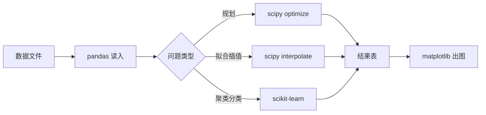

# 第 3 章：计算工具与求解器

- **难度**：★☆☆ | **预估学时**：2 小时 | **前置**：第 1、2 章

## 学习目标

学完本章，你能：

- 用 Python 在一台干净电脑上装好建模要用的五个库；
- 看懂教材里的 MATLAB 代码，并把它翻成 Python；
- 知道什么该用求解器，什么必须自己写循环。

## 一句话核心

建模比赛里 90% 的计算是「把数据读进来 → 调一个求解函数 → 把结果画出来」，三行代码能解决的事，不要手推。

## 零基础讲解

### 概念 1：两套工具的分工（难度：基础）

- **Python**：免费、库全、画图和数据处理顺手。建模首选。
- **MATLAB**：教材代码几乎都是它，矩阵操作写起来短，优化工具箱成熟。学校机房常有正版。
- **LINGO**：专做规划模型，写约束像写方程，适合第 16 章的多目标与目标规划。

不必三样都精。选定 Python 为主，遇到教材 MATLAB 代码照着翻，LINGO 只在写复杂规划时借用。

### 概念 2：五个库各管什么（难度：基础）

| 库 | 管什么 | 典型调用 |
|---|---|---|
| numpy | 数组与矩阵运算 | `np.array`、`np.linalg.solve` |
| scipy | 优化、插值、积分、统计分布 | `scipy.optimize.linprog`、`scipy.interpolate` |
| pandas | 读写 Excel/CSV、分组统计 | `pd.read_excel`、`df.groupby` |
| matplotlib | 画折线、散点、热力图 | `plt.plot`、`plt.scatter` |
| scikit-learn | 聚类、分类、回归、降维 | `KMeans`、`SVM`、`PCA` |

装环境一条命令：

```bash
pip install numpy scipy pandas matplotlib scikit-learn openpyxl
```

国内网络慢就加清华源：`pip install -i https://pypi.tuna.tsinghua.edu.cn/simple numpy scipy pandas matplotlib scikit-learn openpyxl`。

### 概念 3：求解器的输入格式（难度：进阶）

所有优化函数都要求你把模型写成矩阵形式：目标系数 c、约束矩阵 A、约束右端 b。这是第 1 章三要素的机器版本。

线性规划例子：最大化 z = 4x₁ + 3x₂，满足 2x₁ + x₂ ≤ 10、x₁ + x₂ ≤ 8、x₂ ≤ 7、x₁,x₂ ≥ 0。

```python
import numpy as np
from scipy.optimize import linprog

# scipy 只做最小化，最大化要取负
c = [-4, -3]
A = [[2, 1], [1, 1], [0, 1]]
b = [10, 8, 7]
res = linprog(c, A_ub=A, b_ub=b, bounds=[(0, None), (0, None)], method="highs")
print(res.x, -res.fun)   # [2. 6.] 26.0
```

跑出来 x = (2, 6)，利润 26 千元。这个数可以手算核对：两条前约束都恰好取等，第三条约 6 ≤ 7 未取等。

**MATLAB 对照**：`linprog` 名字一样，但 MATLAB 默认最小化、约束写成 `A*x <= b`，语句是 `[x,fval] = linprog(c,A,b,[],[],lb)`。教材里常见的 `optimproblem` 写法是「基于问题」的新接口，Python 里没有对应物，翻译时改回矩阵形式即可。

### 概念 4：什么时候不能靠现成函数（难度：进阶）

三类活必须自己写：

- **模型本身要迭代**：遗传算法、模拟退火、粒子群，外层循环是你的，目标函数也是你的。
- **中间步骤要存数据**：比如逐月滚动预测，每步结果要进表，函数只给你最后答案。
- **结果要解释**：求解器只给数值，灵敏度分析要你改参数重跑十几次，画成曲线。

判断标准很简单：如果函数返回的东西不够你写论文，就得自己搭流程。

## 图示



看图说明：数据进、图出，中间那条判断分支决定你调哪个库。比赛里卡住，通常卡在 B 或 C：数据读不进来，或者没判断清问题类型。

## 类比与实例

- **类比**：求解器像自动售货机，你投进去的必须是标准硬币，即矩阵格式的模型；投一张手写纸条，它不认。失效边界：售货机不会告诉你硬币投错了面额，求解器会返回 status 码，要学会看 `res.status` 和 `res.message`。
- **实例（可复现）**：把上面例子改成「乙机床至少生产 4 台」，加约束 −x₂ ≤ −4。重跑得到 x = (2, 6) 不变，因为 6 ≥ 4 本来就满足。再把乙的利润从 3 改成 5，c 变成 [−4, −5]，最优解变成 x = (0, 8)？手算检验：x₂ 上限 7，x₁ + x₂ ≤ 8，取 x₂ = 7 则 x₁ ≤ 1，利润 = 4×1 + 5×7 = 39；取 x₂ = 6、x₁ = 2 得 8 + 30 = 38。所以最优是 (1, 7)，39。程序会给出同样的答案，不一致就说明代码写错了。

## 常见误解

- 别以为装了 Anaconda 就万事大吉——实际上环境一多，`import scipy` 会指到旧版本。一个项目一个虚拟环境，比什么都装强。
- 别以为 MATLAB 代码能直接照抄——实际上索引从 1 开始、矩阵乘法 `*` 与点乘 `.*` 的差别，翻译时全是坑。
- 别以为求解器返回了数就是成功——实际上 `status=2` 表示不可行，`status=3` 表示无界。先看状态码，再看解。

## 自测题（答案与解析）

### Q1 【单选】用 scipy 求最大化问题，目标函数系数应该怎么写？
- A. 原样写正数
- B. 全部取负
- C. 取倒数
- D. 加一个常数
**答案**：B
**解析**：`linprog` 只做最小化，最大化 z 等价于最小化 −z，所以系数取负，最后把 `res.fun` 再取负还原。

### Q2 【单选】下列哪件事适合自己写循环，而不是调现成函数？
- A. 解线性方程组
- B. 三次样条插值
- C. 模拟退火搜索最优参数
- D. 计算协方差矩阵
**答案**：C
**解析**：模拟退火的降温策略、邻域生成、接受概率都要你自己定，没有通用函数可套。

### Q3 【填空】求解器返回 `status=2`，含义是问题________。
**答案**：不可行
**解析**：2 表示找不到满足全部约束的解，通常是约束写矛盾了，比如同时要求 x ≥ 5 和 x ≤ 3。

## 复习锚点

- Python 为主，MATLAB 用来读教材代码，LINGO 只在复杂规划时上场。
- 优化函数只吃矩阵，模型要先翻译成 c、A、b。
- 先看 status，再看解；不可行和无界是两种完全不同的错。
