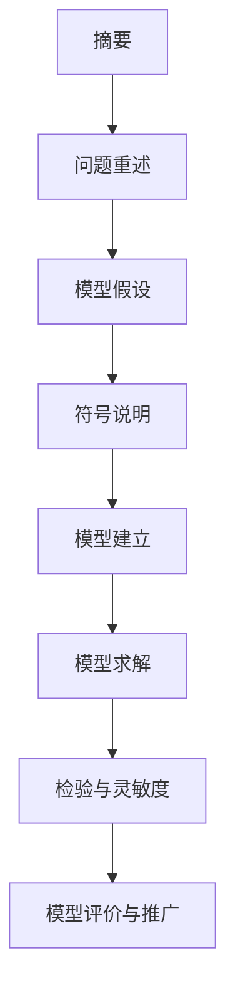

# 第 4 章：论文的骨架

- **难度**：★★☆ | **预估学时**：2.5 小时 | **前置**：第 1 章

## 学习目标

学完本章，你能：

- 按「摘要四段式」写出带具体数字的摘要；
- 说清假设、符号说明、模型建立、求解、检验、评价六块各写什么；
- 用评委的视角给自己的稿子挑出三处硬伤。

## 一句话核心

数模论文不是实验报告，它是一份说服文档：用一页摘要让人相信你解决了问题，用后面二十页证明你没吹牛。

## 零基础讲解

### 概念 1：摘要四段式（难度：基础）

摘要占分最重，评委平均只花两三分钟看一篇。四段结构：

1. **背景与任务**：一两句，说清你面对什么、要回答哪几问。
2. **方法**：每问一句话，点出模型名和关键处理。不要写「我们建立了模型」这种空话。
3. **结果**：给数字。最优方案是多少、预测值多少、误差多少。
4. **结论与推广**：一句结论，一句模型能用到哪。

反面例子：「本文建立了科学的数学模型，运用先进算法，得到了合理结论。」这句话删掉不影响任何信息。

正面例子：「第 1 问建立以日利润最大为目标的线性规划模型，求得甲 2 台、乙 6 台，日利润 2.6 万元；第 2 问将机器可用工时视为随机变量，用 Monte Carlo 模拟 10 万次，得期望利润 2.41 万元，90% 置信区间 [2.05, 2.77]。」

### 概念 2：六块正文（难度：基础）

| 板块 | 写什么 | 常见毛病 |
|---|---|---|
| 问题重述 | 用自己的话压缩题意，标出每一问 | 整段抄题目 |
| 模型假设 | 每条假设附一句理由 | 写「假设数据真实」这种废话 |
| 符号说明 | 表格，符号、含义、单位 | 正文里冒出表里没有的符号 |
| 模型建立 | 从假设推到式子，一步一行 | 直接甩公式，不讲为什么这么建 |
| 模型求解 | 算法步骤 + 关键结果 + 图表 | 只贴代码不解释 |
| 检验与评价 | 灵敏度、误差、优缺点 | 只夸不批，或只批不改 |

### 概念 3：灵敏度分析（难度：进阶）

**灵敏度分析**：把模型里的某个参数上下改 10%，看结论变不变。变很多说明模型脆弱，变很少说明结论稳。

写法：固定其他条件，让参数 α 从 0.005 扫到 0.05，步长 0.001，画出「参数—目标值」曲线，标出拐点。

这一块最容易被跳过，也最容易加分。评委看到你主动承认「当原材料价格上涨 15% 时，最优产量从 6 台降到 4 台」，会认为你真懂模型，而不是跑通代码。

### 概念 4：图表的规矩（难度：基础）

- 图要有编号和图题，图题在图下方；表题在表上方。
- 坐标轴写量和单位，别只写「值」。
- 一张图只讲一件事。把六条曲线塞进一张图，读者只会记住「很乱」。
- 正文必须提到每一张图表。「如图 3 所示」后面要跟一句结论，不能只放图。

## 图示

看图说明：顺序就是评委的阅读顺序。摘要独立成篇，正文按这个链条推进。任何一块缺失，读者会在那里停下来怀疑你。

## 类比与实例

- **类比**：论文像打官司。摘要是一页诉状，假设是你的证据清单，模型是推理，结果是判决，灵敏度是「换一个法官也这么判」。失效边界：法庭要求排除一切合理怀疑，建模只要求结论在参数扰动下站得住。
- **实例（摘要改写）**：原句「我们对数据进行了预处理，并建立了预测模型，取得了较好的效果」。改成：「对 2019—2023 年共 60 个月的数据做缺失值线性插值与异常值 3σ 剔除，保留 58 条；建立 ARIMA(1,1,1) 模型，AIC 为 412.3，样本外 6 个月预测的平均绝对百分比误差为 4.7%」。同样一段，信息量差十倍。

## 常见误解

- 别以为字数多就分高——实际上超页会被扣分，评委也没耐心。每句话都要有信息。
- 别以为代码附录可以乱写——实际上附录是可信度的证据。变量名对不上正文，评委会怀疑结果不是跑出来的。
- 别以为模型越高级越好——实际上用对方法比用难方法重要。简单模型加严谨检验，胜过复杂模型加一堆没解释的参数。

## 自测题（答案与解析）

### Q1 【单选】摘要里最不该出现的是？
- A. 具体的最优方案数值
- B. 所用模型名称
- C. 「本文运用先进算法取得良好效果」
- D. 关键误差指标
**答案**：C
**解析**：这句话不含任何可核查信息，删掉不影响理解，属于典型的凑字数。

### Q2 【单选】灵敏度分析的目的是？
- A. 让论文看起来更复杂
- B. 检验结论对参数扰动的稳健性
- C. 提高模型的拟合精度
- D. 减少计算量
**答案**：B
**解析**：改参数看结论变化幅度，判断模型是否脆弱，这是灵敏度分析唯一的用途。

### Q3 【填空】论文中图题应放在图的________方，表题应放在表的________方。
**答案**：下；上
**解析**：这是排版规范，也是评委会一眼看出的格式分。LaTeX 里 `\caption` 位置放错就会颠倒，第 03 册会讲怎么调。

## 复习锚点

- 摘要是四段：任务、方法、数字结果、结论。
- 假设必须带理由，符号表必须覆盖全文。
- 灵敏度分析写「参数变了结论怎么变」，不是写「模型很好」。
