# 第 5 章：72 小时作战流程

- **难度**：★☆☆ | **预估学时**：1 小时 | **前置**：第 1、4 章

## 学习目标

学完本章，你能：

- 排出从开题到交卷的 72 小时时间表，并说清每个节点的交付物；
- 按三人的能力分工，避免两个人同时写同一段；
- 用一张清单在交卷前 30 分钟查出致命错误。

## 一句话核心

72 小时里，最贵的资源不是算力，是「三个人对同一件事的理解一致」。

## 零基础讲解

### 概念 1：时间轴（难度：基础）

| 时段 | 干什么 | 交付物 |
|---|---|---|
| 第 1 天 08:00–12:00 | 读三题、查文献、定题 | 一页选题理由 |
| 第 1 天 13:00–22:00 | 拆问题、定假设、搭模型骨架 | 模型框架图 + 符号表 |
| 第 2 天 08:00–18:00 | 编程求解第一问，跑通全流程 | 能出数的脚本 |
| 第 2 天 19:00–24:00 | 补第二、三问，出初版图表 | 结果表 + 图 |
| 第 3 天 08:00–14:00 | 写正文、做灵敏度 | 论文初稿 |
| 第 3 天 14:00–18:00 | 通读、查数、改图 | 定稿 |
| 第 3 天 18:00–20:00 | 排版、生成 PDF、交卷 | 提交包 |

真实比赛里这张表会滑。滑了之后砍哪块要提前想好：先砍第三问的精细度，再砍灵敏度，绝不要砍摘要和检验。

### 概念 2：三人分工（难度：基础）

- **建模手**：定假设、推式子、判断结果合理性。必须有最终解释权，避免两套模型打架。
- **编程手**：写求解脚本、清洗数据、出图。要求每段代码能单独跑。
- **写作手**：从第一天就动笔，写问题重述、假设、符号表，边做边填正文。

三人不是流水线。每天至少两次对齐：中午对结果，晚上对文字。写作手要看得懂建模手的式子，否则写出来的是两套话。

### 概念 3：选题的三条判据（难度：基础）

1. **数据拿不拿得到**：题目给的数据够不够支撑第一问。要自己找数据的题，先评估两小时内能否找到。
2. **方法有没有把握**：至少有一问你能立刻说出用什么模型。三问全陌生，换题。
3. **上限有多高**：看一眼题目，能不能想到「加分点」——比如加一个灵敏度、做一个对比模型。想不出，说明理解还不够。

### 概念 4：交卷清单（难度：基础）

- 摘要里的每个数字，正文都能找到出处；
- 符号表覆盖全文，正文没有表外符号；
- 每张图有编号、图题、坐标轴单位，正文提到过；
- 附录代码能跑通，变量名与正文一致；
- PDF 打开无乱码，公式不溢出页面，页码连续；
- 文件名与比赛要求一致，压缩包能解压。

这六条里，任何一条出错都可能直接降档。尤其第一条和最后一条，每年都有人栽。

## 图示

```mermaid
gantt
    title 72 小时节奏
    dateFormat  HH:mm
    axisFormat  %Hh
    section 第一天
    选题与文献      :a1, 08:00, 4h
    模型骨架        :a2, 13:00, 9h
    section 第二天
    求解第一问      :b1, 08:00, 10h
    二三问与图表    :b2, 19:00, 5h
    section 第三天
    正文与灵敏度    :c1, 08:00, 6h
    通读与定稿      :c2, 14:00, 4h
    排版交卷        :c3, 18:00, 2h
```

看图说明：注意第一天没有「写论文」的块，但写作手其实全天在写问题重述和假设。甘特图只能画交付物，画不出并行的文字工作。

## 类比与实例

- **类比**：72 小时像一场接力，但棒子要在三个人之间来回传，而不是一人跑一棒。失效边界：接力赛掉棒就输，建模掉一次信息还能补，但补的成本随时间指数上升。
- **实例（一次真实滑档）**：某队第二天 23:00 才发现第一问的约束漏了「机器每天最多运行 8 小时」，此前所有图表都基于错误模型。补救方式：不改模型，把 8 小时作为新约束重跑，图和结论全部重画，凌晨 3 点完成。教训是假设要在第一天写死并互相签字确认。

## 常见误解

- 别以为熬夜能多出活——实际上第三天的错误，八成是第二天没睡够造成的。
- 别以为三个人各干各的最快——实际上不对齐的分工，返工时间比省下的多。
- 别以为交卷前还能大改——实际上最后两小时只做检查，不做修改。改一处，全文数字都要跟着变。

## 自测题（答案与解析）

### Q1 【单选】时间不够时，最先应该砍掉的是？
- A. 摘要
- B. 第三问的精细度
- C. 模型检验
- D. 图表编号
**答案**：B
**解析**：第三问做浅一点仍能得分，摘要和检验缺失是结构性失分，图表编号错是格式硬伤。

### Q2 【单选】三人分工中，对模型有最终解释权的应该是？
- A. 编程手
- B. 写作手
- C. 建模手
- D. 谁有空谁定
**答案**：C
**解析**：两套模型打架时必须有一个人拍板，否则正文和代码会各说各话。

### Q3 【填空】交卷前必须核对：摘要里的每个数字都要能在________找到出处。
**答案**：正文
**解析**：摘要数字与正文不一致，是评委最容易发现的硬伤，通常意味着后期改过结果但没同步摘要。

## 复习锚点

- 第一天定死假设，第二天跑通全流程，第三天只写不改模型。
- 分工要每天两次对齐，写作手从第一天就动笔。
- 最后两小时只检查，不修改。
