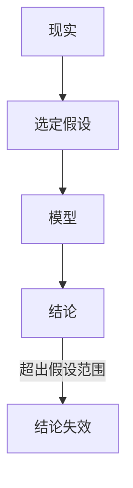

# 假设

<!--chapters: ch01,ch04-->

- **难度**：基础 | **涉及章节**：第 1、4 章

## 一句话定义

假设是你主动决定忽略的东西，它划定了模型能用的范围。

## 为什么重要

模型出错，九成出在假设。写清假设，等于提前告诉读者「哪些情况下我的话不算数」，这比结论本身更能体现水平。

## 图示

## 详解

好假设有两条标准：可检验、有理由。例如「假设原材料价格在三个月内不变，理由是合同锁价」；坏假设是「假设数据真实」，它既不可检验，也不约束任何东西。

类比：假设像合同的适用范围条款。失效边界：合同条款有法律效力，假设只有说服力，评委可以质疑。

## 常见误解

别以为假设写得少显得模型强——实际上不写假设，读者会默认你忽略了所有细节，反而不敢信。

## 在书中出现的脉络

| 章节 | 语境 | 关键结论 |
|---|---|---|
| 第 1 章 | 五步流程 | 检验失败先退回假设 |
| 第 4 章 | 论文六块 | 每条假设附一句理由 |

## 相关概念

- 前置：数学模型
- 后续：灵敏度分析
