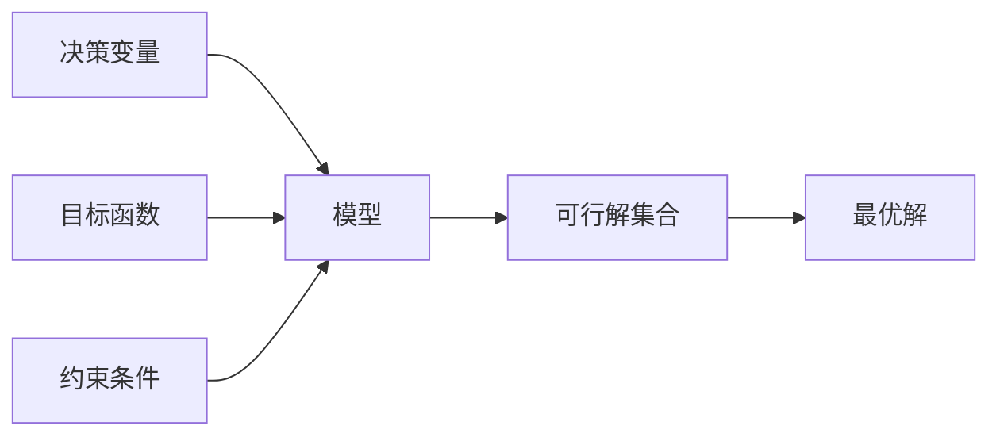

# 三要素

<!--chapters: ch01,ch05-->

- **难度**：基础 | **涉及章节**：第 1、5 章

## 一句话定义

任何优化类模型都由决策变量、目标函数、约束条件三块拼成，缺一块模型就不闭合。

## 为什么重要

它是判断「这题该建什么模型」的最快入口。三要素齐了，剩下的工作只是选算法；三要素缺，再多算法也补不上。

## 图示

## 详解

- 决策变量：你能控制的量。写的时候带上下标和单位，例如 x₁ 表示甲机床日产量，单位台。
- 目标函数：你要优化的量。写成变量表达式，明确最大还是最小。
- 约束条件：资源、时间、物理规律的边界。每条约束背后要有一个现实理由，写不出理由的约束通常是多余的。

类比：点菜。变量是每道菜点几份，目标是总价或总热量，约束是预算和胃口。失效边界：点菜可以中途改主意，模型一旦定下约束，求解过程不会自己松绑。

## 常见误解

别以为约束越多越严谨——实际上每条约束都在缩小可行域，多余的约束可能把最优解切掉。

## 在书中出现的脉络

| 章节 | 语境 | 关键结论 |
|---|---|---|
| 第 1 章 | 首个例题 | 机床厂模型 max 4x₁+3x₂，最优 26 千元 |
| 第 5 章 | 分工 | 三要素由建模手统一口径，避免两套模型打架 |

## 相关概念

- 前置：无
- 后续：线性规划、整数规划、多目标规划
