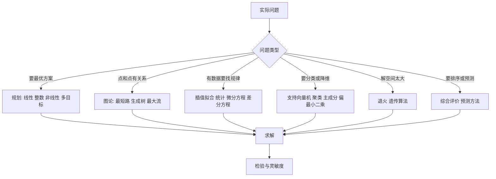

# 《数学建模算法与应用》第 3 版 · 点化学习系统

## 这本书在讲什么

司守奎、孙玺菁这本书把数学建模竞赛里能用的算法按「问题类型」排了一遍：前三章是规划，第四章是图论，第五到八章是连续与离散的分析工具，第九到十一章是机器学习与多元统计，第十二到十六章是启发式、图像、评价、预测与多目标。

它不推导理论，每一章都是「这个方法解决什么问题 + 一道例题 + MATLAB 代码」。所以读它的正确方式不是从头背公式，而是先判断手里的题属于哪一类，再翻到对应章节照着改代码。

## 全书心智模型

## 学习路径（推荐顺序）

| 步骤 | 章节 | 主题 | 前置 | 检查点 |
|---|---|---|---|---|
| 01 | ch01 | 线性规划 | 起步册第 1–3 章 | 手算 (2,6)=26，会算影子价格 |
| 02 | ch02 | 整数规划 | ch01 | 能用分枝定界解一个小例子 |
| 03 | ch03 | 非线性规划 | ch01 | 能判断凸性并写出 KKT |
| 04 | ch04 | 图与网络 | ch01 | 手跑 Dijkstra 与 Kruskal |
| 05 | ch05、ch06 | 插值拟合、微分方程 | 起步册第 2 章 | 手算三点插值与一条拟合直线 |
| 06 | ch07、ch08 | 数理统计、差分方程 | ch05 | 手算 t 检验与平衡点 |
| 07 | ch09–ch11 | SVM、多元分析、PLS | ch07 | 说清聚类与判别的区别 |
| 08 | ch12、ch13 | 现代优化、图像处理 | ch02 | 能设计 GA 五件套 |
| 09 | ch14–ch16 | 评价、预测、多目标 | ch07、ch10 | 手算一次加权排序并做灵敏度 |

## 章节索引

- 第 1 章 线性规划（★★☆）→ chapters/ch01-linear-programming.md
- 第 2 章 整数规划（★★☆）→ chapters/ch02-integer-programming.md
- 第 3 章 非线性规划（★★★）→ chapters/ch03-nonlinear-programming.md
- 第 4 章 图与网络模型及方法（★★☆）→ chapters/ch04-graph-network.md
- 第 5 章 插值与拟合（★★☆）→ chapters/ch05-interpolation-fitting.md
- 第 6 章 微分方程（★★★）→ chapters/ch06-differential-equations.md
- 第 7 章 数理统计（★★★）→ chapters/ch07-statistics.md
- 第 8 章 差分方程（★★☆）→ chapters/ch08-difference-equations.md
- 第 9 章 支持向量机（★★★）→ chapters/ch09-svm.md
- 第 10 章 多元分析（★★★）→ chapters/ch10-multivariate.md
- 第 11 章 偏最小二乘回归分析（★★★）→ chapters/ch11-pls.md
- 第 12 章 现代优化算法（★★☆）→ chapters/ch12-modern-optimization.md
- 第 13 章 数字图像处理（★★☆）→ chapters/ch13-image-processing.md
- 第 14 章 综合评价与决策方法（★★☆）→ chapters/ch14-comprehensive-evaluation.md
- 第 15 章 预测方法（★★★）→ chapters/ch15-forecasting.md
- 第 16 章 多目标规划和目标规划（★★★）→ chapters/ch16-multiobjective.md

## 前置知识（零基础缺口补讲）

| 缺口 | 对应补讲位置 | 学完标志 |
|---|---|---|
| 不知道什么叫约束、目标函数 | 起步册第 1 章 | 能写出三要素 |
| 不会用求解器 | 起步册第 3 章 | 能跑 linprog 并读 status |
| 没学过矩阵特征值 | 起步册第 2 章、本册第 8 章 | 能判断差分方程稳定性 |
| 没写过论文 | 起步册第 4 章、第 03 册 | 能写出带数字的摘要 |
| 不会排版公式 | 第 03 册 LaTeX 6 章 | 能独立排出论文 PDF |

## 术语表 / 模式库 / 速查表 入口

- 术语：glossary.md（87 条）
- 模式库：patterns.md
- 速查表：cheatsheet.md
- 抽认卡：flashcards.md（43 张）
