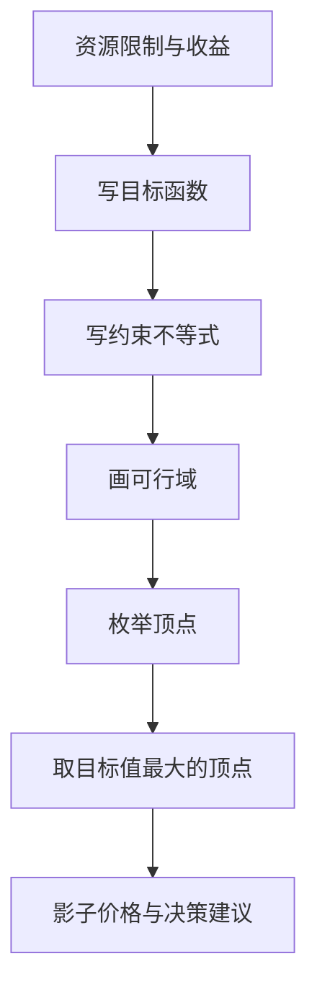

# 第 1 章：线性规划

- **难度**：★★☆ | **预估学时**：5 小时 | **前置**：起步册第 1–3 章 | **原书定位**：第 1 章 p1–17

## 学习目标

学完本章，你能：

- 把「资源有限、要最大化收益」的问题写成标准线性规划；
- 手算二元线性规划的可行域顶点并验证最优解；
- 说清影子价格的含义，并用它回答「多一小时工时值多少钱」。

## 一句话核心

线性规划只做一件事：在凸多边形的可行域里找一个顶点，让目标函数最大。

## 零基础讲解

### 概念 1：线性到底指什么（难度：基础）

**线性规划（LP）**：目标函数和每条约束都是决策变量的一次式，变量之间只加减、不乘除、不平方。

为什么这个限制重要？因为它保证可行域是凸的。凸集合有一个好性质：目标函数在边界上的最大值一定能在某个顶点取到。于是「在无穷多个可行解里找最优」变成「把有限个顶点各算一算」。

### 概念 2：标准型（难度：基础）

教材的统一写法是：

```text
max  z = c₁x₁ + c₂x₂ + … + cₙxₙ
s.t. a₁₁x₁ + … + a₁ₙxₙ ≤ b₁
     ……
     xⱼ ≥ 0
```

min 型、≥ 型、无约束变量，都能通过取负、加松弛变量、拆成两个非负变量转成标准型。软件内部做的就是这套转换，你只要按它的接口喂数。

### 概念 3：可行域与顶点（难度：基础）

**可行域**：所有满足约束的点组成的集合。二维时画出来是一个多边形。

**顶点**：两条约束线的交点。线性规划的最优解（如果存在）一定能在顶点上找到。这也是为什么单纯形法只沿顶点走，不算内部。

### 概念 4：影子价格（难度：进阶）

**影子价格**：某个资源约束的右端项每增加一个单位，目标函数能增加多少。

它等于对偶变量。含义很实用：如果 A 机器工时每小时影子价格是 1 千元，而加班成本是每小时 0.6 千元，那加班划算；反之不划算。

## 图示



看图说明：注意「枚举顶点」这一步在二维才手工可行，三维以上必须交给单纯形法或软件。图里没有「检验」这一步，因为线性规划的解一定满足约束，要检验的是模型假设是否符合现实。

## 类比与实例

- **类比**：线性规划像在有限预算内点菜，菜价和预算是线性的，你要在预算线内选组合让满意度最高。失效边界：真实偏好不是线性的，点多了会腻，这时候模型算出的「全点最贵那道」并不最优。
- **实例（可手算核对）**：某机床厂生产甲、乙两种机床，单台利润 4 千元与 3 千元。甲需 A 机器 2 h、B 机器 1 h；乙需 A、B、C 各 1 h。每天可用工时 A 10 h、B 8 h、C 7 h。
  模型：max z = 4x₁ + 3x₂，s.t. 2x₁ + x₂ ≤ 10，x₁ + x₂ ≤ 8，x₂ ≤ 7，x₁,x₂ ≥ 0。
  顶点：两线交点为 (2, 6)；与 x₂ 轴交 (0, 10) 越界，取 (0, 7)；(1, 7) 处 z = 25；(5, 0) 处 z = 20；(2, 6) 处 z = 26。最优 (2, 6)，日利润 2.6 万元。
  影子价格核对：把 A 的可用工时从 10 改到 11，前两条约束交点变成 (3, 5)，z = 12 + 15 = 27，比 26 多 1。所以 A 的每小时影子价格为 1 千元。

## 常见误解

- 别以为变量越多模型越准——实际上每加一个变量，就多一组约束要交代，没数据支撑的变量只会让解失去意义。
- 别以为最优解一定在可行域内部——实际上线性规划的最优解几乎总在边界顶点，内部点最优只发生在目标函数是常数时。
- 别以为算出「无界」是软件坏了——实际上是你漏了上界约束，比如「产量不限」这种假设，会让利润无限增大。

## 自测题（答案与解析）

### Q1 【单选】线性规划的可行域一定是？
- A. 凸多边形或凸多面体
- B. 圆形
- C. 任意形状
- D. 一条曲线
**答案**：A
**解析**：线性不等式组的交集是凸集，二维时表现为凸多边形，这也是顶点枚举有效的原因。

### Q2 【单选】某约束的影子价格为 0，说明？
- A. 该资源完全用尽
- B. 该资源还有剩余，再增加它不能提高目标值
- C. 模型无解
- D. 该约束写错了
**答案**：B
**解析**：影子价格为零意味着该约束不是紧约束，资源尚有闲置，追加投入不改变最优值。

### Q3 【填空】把 max z 转成 scipy 能接受的形式，需要把目标系数全部________。
**答案**：取负
**解析**：`linprog` 只做最小化，最大化问题等价于最小化 −z，最后把结果取负还原。

## 复习锚点

- 线性 = 一次式，所以可行域凸，最优解在顶点。
- 标准型只有 ≤ 与非负约束，其余形式都靠转换。
- 影子价格 = 右端项加一单位带来的目标增量，用来判断资源该不该追加。
