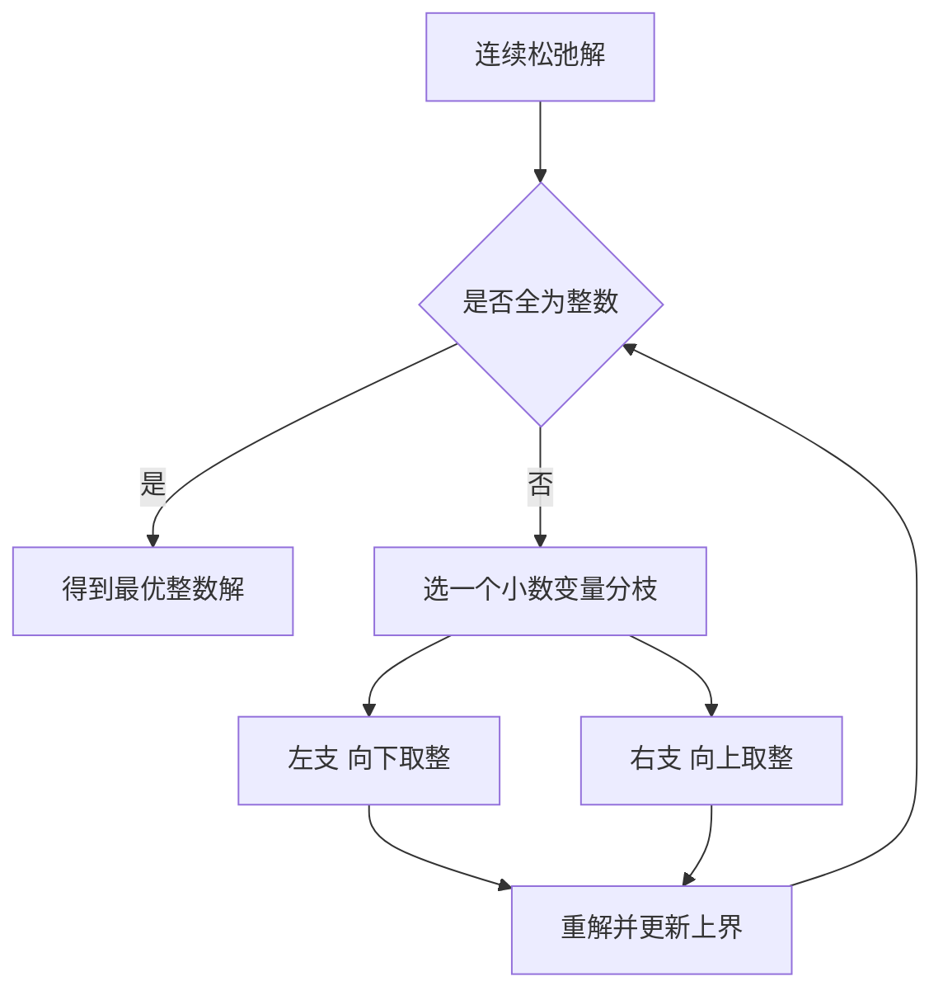

# 第 2 章：整数规划

- **难度**：★★☆ | **预估学时**：5 小时 | **前置**：第 1 章 | **原书定位**：第 2 章 p18–36

## 学习目标

学完本章，你能：

- 判断一个问题为什么不能直接把线性规划的解四舍五入；
- 用分枝定界的手算流程解一个二元小例子；
- 把「要么选要么不选」写成 0-1 变量，把指派问题写成 0-1 规划。

## 一句话核心

整数规划难，不是因为约束多，而是因为可行域被切成了一堆散点，线性规划那套「沿顶点走」的几何直觉失效了。

## 零基础讲解

### 概念 1：整数约束为什么破坏结构（难度：基础）

线性规划的最优解出现在顶点，顶点是连续的。要求 x 取整数后，可行点变成离散的格点，最优格点可能离原来的顶点很远。

一个例子就够：max z = 3x₁ + 4x₂，s.t. 3x₁ + 5x₂ ≤ 8，x₁, x₂ ≥ 0。

连续最优是 (2.667, 0)，z = 8。四舍五入到 (3, 0)，代回约束 3×3 = 9 > 8，直接不可行。退一步取 (2, 0)，z = 6。真正的整数最优是 (1, 1)，z = 3 + 4 = 7，比取整结果高出一档。

一个例子同时暴露两种病：取整可能破坏约束，取整也可能错过更优的格点。这两点就是整数规划不能用「解完取整」的全部理由。

### 概念 2：0-1 变量（难度：基础）

**0-1 变量**：只取 0 或 1 的变量，用来表达「选或不选」。它是整数规划最常用的建模零件。

常用写法：

- 选第 j 个方案：yⱼ ∈ {0,1}，目标里写 cⱼyⱼ。
- 最多选 k 个：∑yⱼ ≤ k。
- A 与 B 不能同时选：y_A + y_B ≤ 1。
- 选了 A 才能选 B：y_B ≤ y_A。

### 概念 3：分枝定界（难度：进阶）

**分枝定界**：先解连续松弛，得到一个小数解；挑一个取小数的变量，把它分成「≤ 下取整」和「≥ 上取整」两支，分别再解；用已找到的整数解作为上界，剪掉不可能更好的分支。

手算流程（以上面的 max 3x₁ + 4x₂，3x₁ + 5x₂ ≤ 8 为例）：

1. 松弛解 x = (2.667, 0)，z = 8，这是上界。
2. 对 x₁ 分枝：x₁ ≤ 2 与 x₁ ≥ 3。x₁ ≥ 3 时 3x₁ ≥ 9 > 8，不可行，剪掉。
3. x₁ ≤ 2 分支：约束变 3x₁ + 5x₂ ≤ 8，x₁ ≤ 2，解出 x₁ = 2, x₂ = 0.4，z = 6 + 1.6 = 7.6。
4. 再对 x₂ 分枝：x₂ ≤ 0 得 (2, 0)，z = 6；x₂ ≥ 1 得 x₁ ≤ 1，解 (1, 1)，z = 7。
5. 比较整数解 6 与 7，取 7。上界 8 已无法再改进，停止。

分枝定界慢，但保证找到最优；启发式（如贪心）快，但不保证。比赛里题目规模小就用精确算法，规模大就用启发式并在论文里说明「近似」。

### 概念 4：指派问题（难度：进阶）

n 个人做 n 件事，每人做每件事的成本不同，求总成本最小的分配。模型是 0-1 规划：xᵢⱼ = 1 表示第 i 人做第 j 事，每行和为 1、每列和为 1。它的特殊结构可以用匈牙利算法在多项式时间求解，不必用通用整数规划。

## 图示

看图说明：这是一棵搜索树，每个节点都是一次线性规划。剪枝的依据是「这个节点的松弛上界已经不如现有整数解」，没有这个上界，树会指数爆炸。

## 类比与实例

- **类比**：整数规划像在一堆整箱货物里装箱，箱子不能拆开。线性规划允许你把箱子切开凑重量，整数规划不允许。失效边界：现实里有时允许拆，比如散装货物，那就退回线性规划。
- **实例（可手算）**：背包容量 5，三件物品重量与价值分别为 (2, 3)、(3, 4)、(4, 5)。枚举 8 种组合：只选 1 得 3；选 2 得 4；选 3 重量 4 得 5；选 1+2 重量 5 得 7；1+3 重量 6 超重；2+3 重量 7 超重；三件全选超重。最优是选第 1、2 件，价值 7。

## 常见误解

- 别以为把线性规划解四舍五入就行——实际上可能既不可行也不是最优，必须验证约束。
- 别以为整数规划只是「加个取整」——实际上它的求解复杂度高一个量级，很多问题是 NP 难的。
- 别以为 0-1 变量只能表示选择——实际上它还能表示「启动成本」「是否开启一条产线」这类固定费用。

## 自测题（答案与解析）

### Q1 【单选】线性规划松弛解为 (2.67, 0)，下列做法正确的是？
- A. 直接四舍五入得 (3, 0)
- B. 以松弛解为上界做分枝定界
- C. 认为问题无解
- D. 把约束改成等式
**答案**：B
**解析**：松弛解给出上界，分枝定界在此之上搜索整数解；直接取整可能违反约束。

### Q2 【单选】「A、B 两个项目最多上一个」应写成？
- A. y_A + y_B ≤ 1
- B. y_A + y_B ≥ 1
- C. y_A − y_B ≤ 1
- D. y_A × y_B ≤ 1
**答案**：A
**解析**：两个 0-1 变量之和不超过 1，恰好表达「至多选一个」；乘积不是线性式，不能出现在线性约束里。

### Q3 【填空】指派问题的约束特点是每行之和为 1、每列之和为________。
**答案**：1
**解析**：一个人只做一件事、一件事只由一个人做，两个方向都恰好为 1，这才构成合法指派。

## 复习锚点

- 整数约束把连续可行域切成格点，几何直觉失效。
- 0-1 变量是表达选择、互斥、依赖的标准零件。
- 分枝定界靠松弛上界剪枝，规模大时改用启发式并说明精度。
