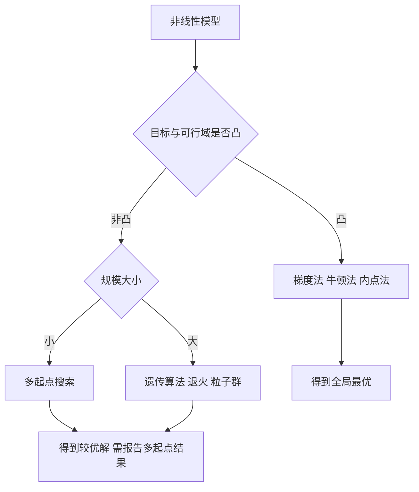

# 第 3 章：非线性规划

- **难度**：★★★ | **预估学时**：6 小时 | **前置**：第 1 章、起步册第 2 章 | **原书定位**：第 3 章 p37–61

## 学习目标

学完本章，你能：

- 判断一个非线性规划是凸的还是可能有多个局部最优；
- 写出 KKT 条件，并用它手算一个带线性约束的极小值问题；
- 说清「罚函数」和「序列二次规划」分别在什么场景下用。

## 一句话核心

线性规划只有一个最优解，非线性规划可能有一堆，算法只保证找到其中一个——所以凸性比算法更重要。

## 零基础讲解

### 概念 1：凸函数与凸规划（难度：基础）

**凸函数**：图像上任意两点连线都在函数图像上方（碗形）。判定方法：二阶导数（一元）或海森矩阵（多元）半正定。

**凸规划**：目标函数凸、可行域凸。它的局部最优就是全局最优，梯度类算法不会掉进坑里。

建模时要先问一句：我的目标函数凸吗？如果凸，放心用算法；如果不凸，要么换建模方式，要么用多起点搜索。

### 概念 2：KKT 条件（难度：进阶）

**KKT 条件**：带约束的极值点必须满足的一组条件，包括：

1. 梯度平衡：∇f + ∑λᵢ∇gᵢ = 0，即目标函数的梯度被约束的梯度「抵消」；
2. 可行性：所有约束满足；
3. 互补松弛：λᵢgᵢ = 0，约束没起作用时乘子为零，起作用时乘子可以为正；
4. 乘子非负（不等式约束）。

一句话理解：在最优点，你没法沿着任何可行方向再改善目标，因为改善方向都被约束挡住了。

### 概念 3：二次规划（难度：进阶）

**二次规划（QP）**：目标函数是二次型，约束是线性的。它是非线性规划里最好解的一类，有成熟算法。

判断标准：目标函数写成 ½xᵀHx + fᵀx，H 半正定则凸。投资组合、最小二乘、支持向量机都归到这里。

### 概念 4：罚函数与启发式（难度：进阶）

- **罚函数法**：把约束违反量加到目标里，min f(x) + M·max(0, g(x))²，M 逐渐增大。优点是简单，缺点是大 M 会让数值病态。
- **梯度法/牛顿法**：沿负梯度方向走，牛顿法用二阶信息，收敛快但对初值敏感。
- **启发式**：不保证最优，只求可用解。目标函数不可导、变量多、有整数约束时常用。

## 图示

看图说明：凸性判断在第二步，很多人跳过它直接调算法，结果在非凸问题上反复得到不同的局部最优，却以为是算法不稳定。

## 类比与实例

- **类比**：凸规划像碗底放球，怎么滚都滚到最低点；非凸规划像山地地形，球可能停在半山腰的小坑里。失效边界：真实优化问题常有多个「小坑」，球的起点决定结果，所以要多起点。
- **实例（可手算）**：min f = (x₁ − 1)² + (x₂ − 2)²，s.t. x₁ + x₂ ≤ 2。
  无约束最优点是 (1, 2)，但 1 + 2 = 3 > 2，不可行。
  最优点必在边界 x₁ + x₂ = 2 上。把 (1, 2) 投影到这条线上：沿法向 (1,1) 移动，移动量 = (3 − 2)/2 = 0.5，得 (0.5, 1.5)。
  代回 f = (0.5 − 1)² + (1.5 − 2)² = 0.25 + 0.25 = 0.5。
  KKT 核对：∇f = (2(x₁−1), 2(x₂−2)) = (−1, −1)，约束梯度 (1, 1)，取 λ = 1 得 (−1,−1) + 1×(1,1) = 0，满足梯度平衡。

## 常见误解

- 别以为软件返回「优化成功」就是全局最优——实际上局部算法只保证局部，非凸问题必须多起点或换全局算法。
- 别以为约束越多越安全——实际上新增约束可能让可行域变成空集，求解器报 status=2。
- 别以为非线性规划一定比线性规划高级——实际上能用线性模型解决的问题，用非线性只会增加不确定性。

## 自测题（答案与解析）

### Q1 【单选】判断多元目标函数是否凸，主要看？
- A. 一阶导数是否为零
- B. 海森矩阵是否半正定
- C. 变量个数
- D. 约束个数
**答案**：B
**解析**：海森矩阵半正定等价于函数凸，这是一元二阶导数判据的推广。

### Q2 【单选】KKT 条件中「互补松弛」的含义是？
- A. 所有约束都必须取等号
- B. 约束未起作用时对应乘子为零
- C. 乘子必须为负
- D. 目标函数必须为零
**答案**：B
**解析**：λᵢgᵢ = 0 表示约束与乘子至少一个为零，未起作用的约束不产生「价格」。

### Q3 【填空】把 (1, 2) 投影到直线 x₁ + x₂ = 2 上，得到的点是________。
**答案**：(0.5, 1.5)
**解析**：沿法向 (1,1) 移动 (3−2)/2 = 0.5，坐标各减 0.5。

## 复习锚点

- 凸性决定算法能不能信，先判凸再选方法。
- KKT 是「无法再改善」的数学表达，互补松弛是核心。
- 非凸问题必须多起点，并在论文里报告不同起点的结果。
