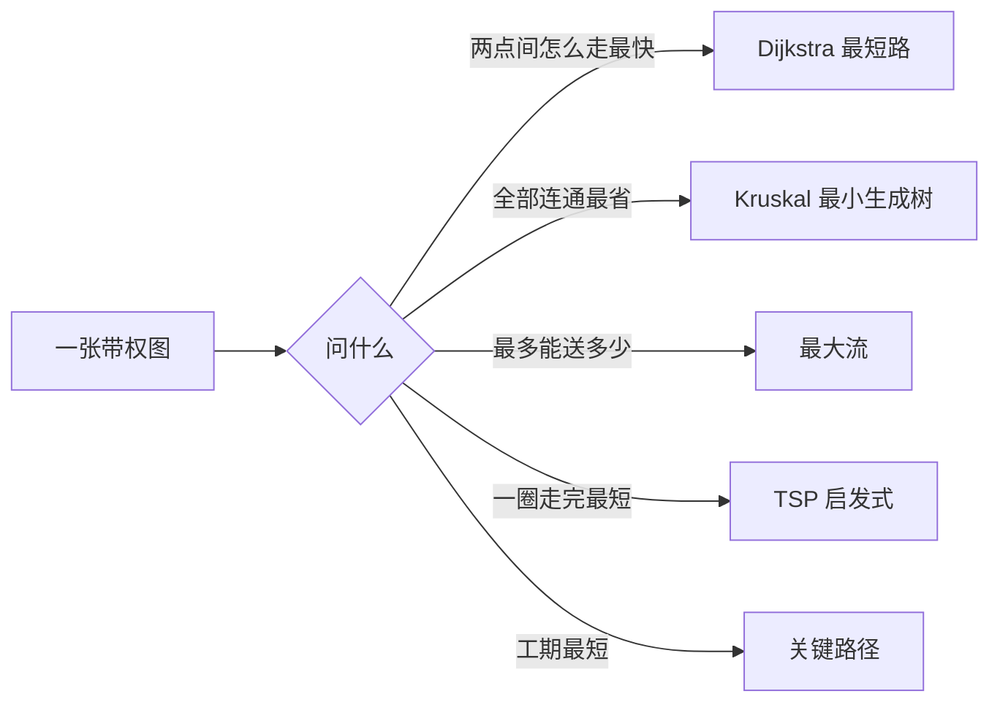

# 第 4 章：图与网络模型及方法

- **难度**：★★☆ | **预估学时**：6 小时 | **前置**：第 1–3 章 | **原书定位**：第 4 章 p62–112

## 学习目标

学完本章，你能：

- 把「点与点之间有关系」的问题画成图，写出邻接矩阵；
- 手跑 Dijkstra 求最短路，手跑 Kruskal 求最小生成树；
- 分清最短路、最小生成树、最大流、TSP、关键路径五类问题各自的用途。

## 一句话核心

图论建模的本质是选对问题类型：同一张图，问法不同，算法完全不同。

## 零基础讲解

### 概念 1：图的三种存法（难度：基础）

**图**：点（顶点）和边组成的结构。边有方向叫有向图，带数字叫带权图。

三种存法各有用途：

- **邻接矩阵** A：aᵢⱼ 表示 i 到 j 有没有边或权值。适合稠密图，矩阵运算方便。
- **邻接表**：每个点存一个邻居列表。适合稀疏图，省空间。
- **边列表**：只存 (起点, 终点, 权重)。适合 Kruskal 这类按边排序的算法。

### 概念 2：最短路（难度：基础）

**Dijkstra 算法**：从起点出发，每次从未确定的点里挑距离最小的，用它去更新邻居，直到所有点确定。要求边权非负。

手算例子：5 个点，边与权值 1-2: 2、1-3: 5、2-3: 1、2-4: 4、3-4: 2、3-5: 6、4-5: 1。

1. 起点 1，距离表：1=0，2=2，3=5，4=∞，5=∞。
2. 选 2，更新：3 = min(5, 2+1) = 3；4 = min(∞, 2+4) = 6。
3. 选 3（距离 3），更新：4 = min(6, 3+2) = 5；5 = 3+6 = 9。
4. 选 4（距离 5），更新：5 = min(9, 5+1) = 6。
5. 选 5，结束。最短路 1→2→3→4→5，长度 6。

若边权有负数，Dijkstra 失效，改用 Bellman-Ford 或 Floyd。

### 概念 3：最小生成树（难度：基础）

**生成树**：连通所有点且不含环的子图，n 个点需要 n−1 条边。**最小生成树**是总权重最小的那棵。

Kruskal：把所有边按权重从小到大排序，依次加入，若成环就跳过。上例排序为 2-3:1、4-5:1、1-2:2、3-4:2、1-3:5、3-5:6，取前四条，总权重 1+1+2+2 = 6。

最小生成树回答「怎么连线最省」，最短路回答「从 A 到 B 怎么走最快」，两者不是一回事。

### 概念 4：最大流与关键路径（难度：进阶）

- **最大流**：源点到汇点最多能送多少流量，每条边有容量上限。求解用增广路算法（Ford-Fulkerson / Dinic）。
- **关键路径**：项目管理里，从开工到完工的最长路径，路径上的工序没有机动时间，延误一天整体就延误一天。求法是对 AOE 网络做拓扑排序，算最早开始与最晚开始时间。

### 概念 5：旅行商问题（难度：高难）

**TSP**：从起点出发，遍历所有点各一次再回到起点，求最短路线。它是 NP 难的，点数超过 20 基本只能求近似解，用第 12 章的遗传算法或退火。

## 图示

看图说明：同一个起点问题，五个分支给出五种完全不同的答案。建模时先把「问什么」说清，再选算法。

## 类比与实例

- **类比**：最短路像导航软件算最快路线，最小生成树像给几个村子铺自来水管道总长最短。失效边界：导航考虑实时路况，静态图模型不考虑，所以结果可能和实际差很多。
- **实例（可核算）**：上例中，从 1 到 5 的最短路是 6；若把 3-5 的权值从 6 改成 2，则 1→3→5 长 3+2 = 5，比 6 更短，Dijkstra 第 3 步就会把 5 更新为 5。这说明算法结果依赖权值，权值错一位，结论全变。

## 常见误解

- 别以为最短路和最小生成树可以互换——实际上它们的优化对象不同：一个是一对点的路径，一个是全图的边集。
- 别以为 Dijkstra 能处理负权——实际上负权会让「已确定」的点被再次改进，算法前提被破坏。
- 别以为 TSP 可以用最短路算法解决——实际上 TSP 要求遍历全部点，复杂度高得多。

## 自测题（答案与解析）

### Q1 【单选】n 个点的最小生成树有几条边？
- A. n
- B. n−1
- C. n+1
- D. 不确定
**答案**：B
**解析**：树的性质：n 个顶点、n−1 条边、无环且连通。

### Q2 【单选】Dijkstra 算法不适用的情形是？
- A. 边权为正
- B. 存在负权边
- C. 图是稠密图
- D. 图是有向图
**答案**：B
**解析**：负权会破坏「已确定点的距离不会再变小」这一前提，需要改用 Bellman-Ford。

### Q3 【填空】关键路径上任何一道工序延误，整个工期都会________。
**答案**：延误
**解析**：关键路径的总时差为零，路径上工序没有机动时间，任一延误直接传导到总工期。

## 复习锚点

- 图有三存法：矩阵、邻接表、边列表，按算法选。
- 最短路是点对问题，最小生成树是全图问题。
- TSP 是 NP 难的，规模大就上启发式并说明近似。
