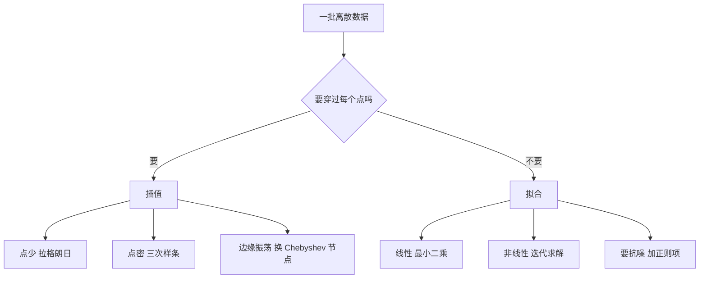

# 第 5 章：插值与拟合

- **难度**：★★☆ | **预估学时**：5 小时 | **前置**：第 1 章、起步册第 2 章 | **原书定位**：第 5 章 p113–149

## 学习目标

学完本章，你能：

- 说清插值和拟合的根本区别，并据此选方法；
- 手算三点二次插值，理解 Runge 现象为什么发生；
- 手算一次最小二乘拟合的斜率与截距，并解释残差。

## 一句话核心

插值要求曲线穿过每一个已知点，拟合允许曲线不穿过，只要求整体误差最小。前者补空缺，后者找规律。

## 零基础讲解

### 概念 1：插值（难度：基础）

**插值**：已知 n+1 个点，构造一条曲线必须经过这些点，用来估计中间点的值。

n+1 个点可以唯一确定一个次数不超过 n 的多项式，这就是**拉格朗日插值**。公式写起来吓人，本质是「每个点配一个权重函数，权重在该点为 1、在别的点为 0」。

手算例子：三点 (0, 1)、(1, 3)、(2, 2)，求 x = 1.5 处的值。

先定二次多项式 P(x) = ax² + bx + c。代入三点得 c = 1、a + b = 2、4a + 2b = 1，解得 a = −1.5、b = 3.5。于是 P(1.5) = −1.5×2.25 + 3.5×1.5 + 1 = 2.875。

用拉格朗日权重核对：L₀ = (x−1)(x−2)/2 在 1.5 处为 −0.125，L₁ = x(x−2)/(−1) 为 0.75，L₂ = x(x−1)/2 为 0.375；加权 1×(−0.125) + 3×0.75 + 2×0.375 = 2.875，一致。

### 概念 2：Runge 现象（难度：进阶）

**Runge 现象**：等距节点上提高多项式次数，区间边缘的插值曲线会剧烈振荡，误差反而变大。

经典反例是 f(x) = 1/(1 + 25x²) 在 [−1, 1] 上插值，次数越高边缘越离谱。解决办法有两个：改用分段低次插值（三次样条），或改用 Chebyshev 节点（中间密、两端疏）。

这条现象的意义在于：不要以为「点越多、次数越高越准」。数据密集处插值反而更不稳。

### 概念 3：三次样条（难度：进阶）

**三次样条**：把区间分成若干段，每段用三次多项式，并要求在节点处函数值、一阶导数、二阶导数连续。它比高次多项式稳，比折线光滑，是工程最常用的插值。

代价是要解一个三对角线性方程组求各段的系数，手算不现实，交给 `scipy.interpolate.CubicSpline`。

### 概念 4：最小二乘拟合（难度：基础）

**拟合**：不要求穿过点，只要求残差平方和最小。

一元线性拟合手算：数据 (1, 2)、(2, 3)、(3, 5)。

x̄ = 2，ȳ = 10/3 ≈ 3.333。
斜率 b = ∑(xᵢ − x̄)(yᵢ − ȳ) / ∑(xᵢ − x̄)² = [(−1)(−1.333) + 0 + (1)(1.667)] / (1 + 0 + 1) = 3 / 2 = 1.5。
截距 a = ȳ − b x̄ = 3.333 − 3 = 0.333。
拟合直线 y = 0.333 + 1.5x。残差：x=1 时 −0.167，x=2 时 +0.333，x=3 时 +0.167，平方和 0.167。

### 概念 5：函数逼近（难度：进阶）

**函数逼近**：用简单函数（多项式、三角多项式）去近似一个复杂函数，误差用最大偏差或平方积分衡量。它与拟合的区别是：拟合面对离散数据，逼近面对已知函数。

## 图示

看图说明：判断点全在「要不要穿过每个点」。这个判断错了，后面所有方法都白选。

## 类比与实例

- **类比**：插值像照着几个路标画一条必须经过它们的路线，拟合像根据几个路标推断大方向，不要求路线压在路标上。失效边界：路标本身测错了怎么办？插值会把错误原样带进曲线，拟合能部分抵消，所以数据有噪声时优先拟合。
- **实例（可核算）**：某地 2019—2023 年用水量分别为 12、13、13.5、14、15 亿立方米，问 2024 年。若用线性拟合，斜率约 0.75，预测 15.75；若用二次插值，末端会翘得更高。差别来自方法假设，不是数据本身，论文里必须说明为什么选这个方法。

## 常见误解

- 别以为插值一定比拟合准——实际上数据有噪声时，插值会把噪声当成规律。
- 别以为次数越高越好——实际上高次多项式会振荡，三次样条通常更稳。
- 别以为拟合就是画一条直线——实际上可以拟合任意形式的函数，关键是先定函数形式，再定参数。

## 自测题（答案与解析）

### Q1 【单选】插值与拟合最根本的区别是？
- A. 插值用多项式，拟合不用
- B. 插值必须经过所有数据点，拟合不要求
- C. 插值只能用于一维
- D. 拟合需要更多数据
**答案**：B
**解析**：是否穿过数据点，决定了误差的处理方式，也是一切方法选择的起点。

### Q2 【单选】Runge 现象说明？
- A. 节点越多，插值一定越准
- B. 等距节点上高次多项式插值在边缘会剧烈振荡
- C. 三次样条不收敛
- D. 拟合不能用于函数逼近
**答案**：B
**解析**：次数升高时边缘误差可能发散，这是等距节点的固有缺陷。

### Q3 【填空】数据 (1,2)、(2,3)、(3,5) 的最小二乘直线斜率为________。
**答案**：1.5
**解析**：分子 3、分母 2，斜率 1.5，截距约 0.333。

## 复习锚点

- 插值穿点，拟合不穿点；噪声大时选拟合。
- 高次多项式会振荡，三次样条更稳。
- 最小二乘的斜率是「协方差除以方差」。
