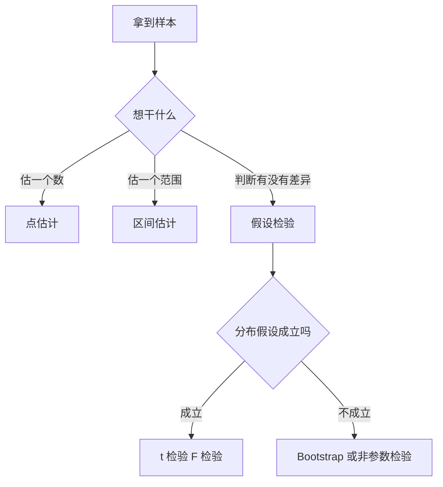

# 第 7 章：数理统计

- **难度**：★★★ | **预估学时**：6 小时 | **前置**：起步册第 2 章、第 5 章 | **原书定位**：第 7 章 p182–230

## 学习目标

学完本章，你能：

- 分清点估计、区间估计、假设检验各自回答什么问题；
- 手算一次单样本 t 检验，正确解读 p 值；
- 说清 Bootstrap 在没有分布假设时怎么给出置信区间。

## 一句话核心

统计推断的全部结论都是概率性的：它说的是「在多大程度上可以不相信原假设」，不是「真相是什么」。

## 零基础讲解

### 概念 1：点估计与区间估计（难度：基础）

**点估计**：用样本算出的一个数去猜总体参数，比如用样本均值 x̄ 猜总体均值 μ。

**区间估计**：给出一个区间，并声明「真值落在里面的概率约为 95%」。严格说法是：重复抽样很多次，约有 95% 的区间会覆盖真值。单次抽样得到的那个区间，要么覆盖要么不覆盖，没有 95% 的概率可言。

置信区间宽度取决于三件事：样本量越大越窄，标准差越小越窄，置信水平越高越宽。

### 概念 2：假设检验与 p 值（难度：进阶）

**假设检验**：先设一个原假设 H₀（通常是「没有差异」），再看样本结果在 H₀ 成立时有多罕见。

**p 值**：如果 H₀ 为真，出现当前或更极端结果的概率。p 小，说明结果罕见，于是拒绝 H₀。

手算例子：某产品标准厚度 10 mm，抽 5 件测得 10、12、11、13、9，问均值是否偏离 10。

x̄ = 11，偏差 −1、1、0、2、−2，平方和 10，s² = 10/(5−1) = 2.5，s = 1.581。
标准误 SE = s/√5 = 0.707。
t = (11 − 10)/0.707 = 1.414，自由度 4。
查表：双侧 5% 临界值 2.776，1.414 < 2.776，p > 0.05，不拒绝 H₀。

结论写法：「没有足够证据说明均值偏离 10 mm」，不能说「均值就是 10 mm」。后者是把「没证据」当成「证据没有」。

### 概念 3：Bootstrap（难度：进阶）

**Bootstrap**：从样本里有放回地抽 n 个，算一次统计量，重复几百上千次，用这些统计量的分布近似抽样分布。

它不需要假设正态，适合小样本、偏态分布、复杂统计量（如中位数、R²）。局限是：如果样本本身不能代表总体，Bootstrap 只会把偏差放大。

### 概念 4：方差分析与回归（难度：进阶）

- **方差分析（ANOVA）**：比较三组以上均值是否相同。核心是把总变异拆成组间与组内，用 F 统计量判断组间差异是否显著。
- **回归**：用一个或多个自变量解释因变量。多元回归要检查共线性、残差正态性、异方差，R² 高不代表模型可用。

## 图示

看图说明：先确定问题类型，再看分布假设。很多误用发生在直接跳到 t 检验，却不管数据是否近似正态。

## 类比与实例

- **类比**：假设检验像法庭，H₀ 是「无罪」，p 值是「如果无罪，出现这些证据的概率」。p 小只能说明证据罕见，不等于证明有罪。失效边界：法庭要求排除合理怀疑，统计只给概率，两者不能直接类比定罪。
- **实例（可核算）**：某药两组各 10 人，试验组均值 8.2、标准差 1.5，对照组 9.1、标准差 1.8。差值 0.9，合并标准误约 √(1.5²/10 + 1.8²/10) = √(0.225 + 0.324) = 0.745，t ≈ 1.21，p > 0.05。结论是「未见显著差异」，样本量再多一些才可能看出效果。

## 常见误解

- 别以为 p < 0.05 就代表结论重要——实际上 p 只衡量罕见程度，效应大小要看差值本身。
- 别以为不显著就是没差异——实际上可能只是样本太小、噪声太大。
- 别以为 R² 高就是模型好——实际上加变量就能抬高 R²，要看调整 R² 和残差诊断。

## 自测题（答案与解析）

### Q1 【单选】p 值的正确解读是？
- A. H₀ 为真的概率
- B. H₀ 为真时出现当前或更极端结果的概率
- C. 结论正确的概率
- D. 效应量大小
**答案**：B
**解析**：p 值是条件概率，条件是 H₀ 成立，它不告诉你 H₀ 本身真不真。

### Q2 【单选】Bootstrap 的核心操作是？
- A. 增加样本量
- B. 有放回重抽样并重复计算统计量
- C. 对数据做正态化变换
- D. 删除异常值
**答案**：B
**解析**：通过重抽样模拟抽样分布，避免对分布形式做强假设。

### Q3 【填空】样本 10、12、11、13、9 的标准差约为________。
**答案**：1.58
**解析**：偏差平方和 10，除以自由度 4 得 2.5，开方约 1.581。

## 复习锚点

- 点估计给数，区间估计给范围，假设检验给「能不能不信 H₀」。
- p 值不是 H₀ 为真的概率，也不是结论正确的概率。
- Bootstrap 免分布假设，但不能修正样本本身的偏差。
