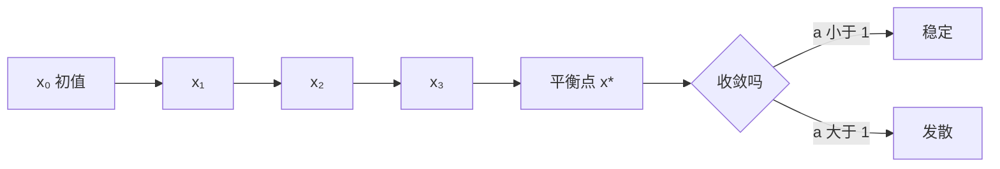

# 第 8 章：差分方程

- **难度**：★★☆ | **预估学时**：5 小时 | **前置**：第 6 章、起步册第 2 章 | **原书定位**：第 8 章 p231–247

## 学习目标

学完本章，你能：

- 把「今年的数量取决于去年的数量」写成差分方程；
- 用特征根判断一阶与二阶系统的稳定性；
- 写出 Leslie 矩阵，并解释它预测种群规模的逻辑。

## 一句话核心

差分方程是离散版的微分方程：微分方程看连续时间的变化率，差分方程看相邻两期的差值。

## 零基础讲解

### 概念 1：差分与递推（难度：基础）

**差分方程**：含 xₙ、xₙ₊₁ 这类相邻项关系的方程。

最简单的形式：xₙ₊₁ = a xₙ + b。

**平衡点**：使 xₙ₊₁ = xₙ 的值，解得 x* = b/(1 − a)（a ≠ 1）。

例：xₙ₊₁ = 0.8xₙ + 20，平衡点 x* = 20/(1 − 0.8) = 100。从 x₀ = 10 出发：x₁ = 28、x₂ = 42.4、x₃ = 53.9……逐期逼近 100，差值每期缩小到 0.8 倍。

### 概念 2：稳定性（难度：进阶）

**稳定**：初值的小扰动会随时间消失，系统回到平衡点。

一阶系统 xₙ₊₁ = a xₙ + b 稳定的条件是 |a| < 1。|a| > 1 发散，a = −1 振荡不收敛。

二阶系统 xₙ₊₂ = p xₙ₊₁ + q xₙ 的特征方程是 λ² − pλ − q = 0，两个根都落在单位圆内（|λ| < 1）才稳定。

判断稳定性的意义：模型预测长期趋势时，不稳定系统的小误差会被放大到荒谬。

### 概念 3：Leslie 矩阵（难度：进阶）

**Leslie 矩阵**：按年龄分组，把繁殖率和存活率排成矩阵，用来预测种群规模。

```
[ F₁  F₂  F₃ ]
[ S₁   0   0 ]
[ 0   S₂   0 ]
```

第一行是各年龄组的繁殖贡献，下面是对角线错一位的存活率。下一期种群向量 = 矩阵 × 本期向量。

矩阵的主特征值 λ₁ 决定长期增长率：λ₁ > 1 增长，< 1 衰退。稳定年龄分布由对应的特征向量给出。

### 概念 4：典型建模场景（难度：基础）

- **存贷款**：余额按复利增长，每月还款固定，写成 xₙ₊₁ = 1.01xₙ − A。
- **捕鱼策略**：幼鱼长成成鱼需要年限，成鱼被捕捞，用 Leslie 矩阵加捕捞项。
- **设备更新**：每年淘汰固定比例，同时购入新设备。

## 图示



看图说明：箭头是逐期递推，虚线指向平衡点。判断稳定性看的是「越来越近还是越来越远」，不是看某一期的数值。

## 类比与实例

- **类比**：差分方程像每月还信用卡，欠款 = 上月欠款 × 利率 − 本月还款。失效边界：真实还款可能逾期、利率会浮动，固定参数的模型只能描述理想情况。
- **实例（可核算）**：某渔场成鱼每年捕捞 30%，幼鱼存活率 50%，成鱼繁殖率每尾 2 尾。简化为两龄模型，Leslie 矩阵 [[2, 0],[0.5, 0]]，特征值 2 与 0，λ = 2 > 1，种群按每年 2 倍增长——这显然不符合实际，说明繁殖率参数取得过高，需要按实测数据校准。

## 常见误解

- 别以为差分方程只是微分方程的近似——实际上很多离散过程（年度普查、月度库存）本身就是离散的，差分方程是原始模型。
- 别以为平衡点就是稳定点——实际上平衡点可能不稳定，初值稍偏就越走越远。
- 别以为 Leslie 矩阵只用于动物——实际上人口预测、客户留存、设备寿命都能用同构模型。

## 自测题（答案与解析）

### Q1 【单选】xₙ₊₁ = 0.8xₙ + 20 的平衡点是？
- A. 20
- B. 80
- C. 100
- D. 120
**答案**：C
**解析**：令 x = 0.8x + 20，得 0.2x = 20，x = 100。

### Q2 【单选】一阶系统稳定的条件是？
- A. |a| < 1
- B. a > 0
- C. b = 0
- D. |a| > 1
**答案**：A
**解析**：每期误差按 a 倍缩放，|a| < 1 才会衰减到零。

### Q3 【填空】Leslie 矩阵的主特征值大于 1 表示种群长期________。
**答案**：增长
**解析**：主特征值是每期的渐近增长倍数，大于 1 意味着规模逐年扩大。

## 复习锚点

- 差分方程描述相邻两期的关系，平衡点由 x = ax + b 解出。
- 稳定性看特征根的模是否小于 1。
- Leslie 矩阵 = 繁殖率首行 + 存活率次对角线，主特征值定长期趋势。
