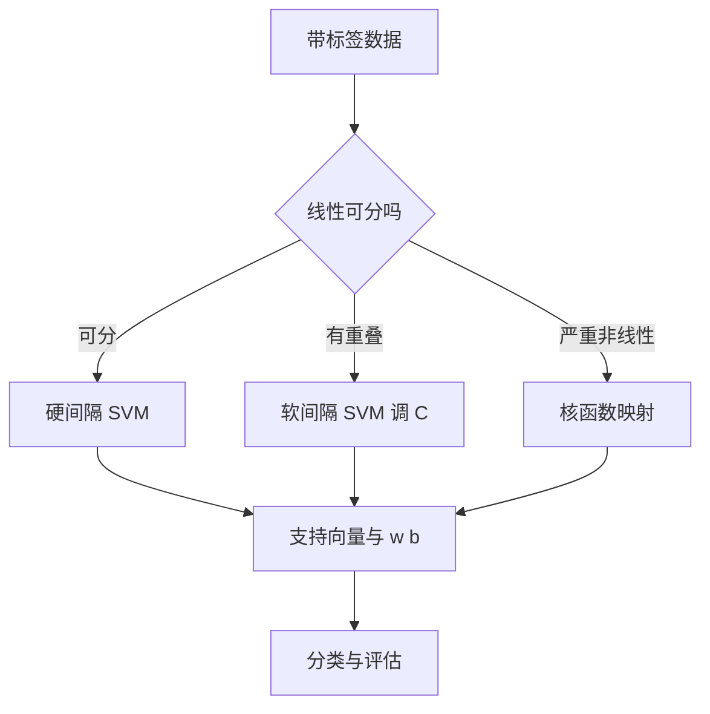

# 第 9 章：支持向量机

- **难度**：★★★ | **预估学时**：5 小时 | **前置**：第 3 章、起步册第 2 章 | **原书定位**：第 9 章 p248–261

## 学习目标

学完本章，你能：

- 说清「最大间隔」为什么比「能分开」更好；
- 用 w 与 b 写出决策函数，并算出给定点的间隔；
- 解释核函数与惩罚参数 C 各自解决什么问题。

## 一句话核心

支持向量机不找一条能分开的线，而是找那条离两类点都最远的线。

## 零基础讲解

### 概念 1：最大间隔（难度：基础）

**支持向量机（SVM）**：二分类模型，目标是找一个超平面 wᵀx + b = 0，使两类点到它的最小距离最大。

**间隔**：两类支持向量到超平面的距离之和，等于 2/‖w‖。最大化间隔等价于最小化 ‖w‖²/2。

为什么间隔大好？因为新数据不会正好落在边界上。间隔是模型的「安全余量」。

手算例子：正类点 (1,1)、(2,2)，负类点 (−1,−1)、(−2,−2)。取 w = (1,1)、b = 0，决策线 x₁ + x₂ = 0。

支持向量到线的距离：|1+1|/√2 = √2 ≈ 1.414。两类点分居线两侧，所以两类之间的间隔带宽度是 2√2 ≈ 2.828。

这与公式 2/‖w‖ 是同一件事，只是 w 的尺度不同。公式里的 w 已被缩放成「支持向量处取 ±1」；本例 wᵀ(1,1) = 2，缩放一半得 w′ = (0.5, 0.5)，‖w′‖ = 0.707，2/‖w′‖ = 2.828，与几何距离对得上。

**支持向量**：离超平面最近的那些点。它们决定了 w 和 b，其他点删掉不影响结果。

### 概念 2：软间隔与 C（难度：进阶）

真实数据常有重叠，硬间隔无解。引入**松弛变量** ξᵢ ≥ 0，允许个别点越界，目标改为：

```text
min ½‖w‖² + C∑ξᵢ
s.t. yᵢ(wᵀxᵢ + b) ≥ 1 − ξᵢ
```

**C** 是惩罚系数：

- C 大 → 不容忍越界，间隔窄，容易过拟合；
- C 小 → 容忍越界，间隔宽，偏差大。

调 C 是 SVM 最常做的超参数搜索。

### 概念 3：核函数（难度：进阶）

数据在原空间线性不可分时，用**核函数**把它们隐式映射到高维，在高维找超平面。

常用核：

- 线性核：特征多、样本少时用；
- 多项式核：有明显交互项时用；
- RBF 核（高斯核）：默认首选，参数 γ 控制影响范围，γ 大则每个点影响范围小，容易过拟合。

核技巧的关键：不需要真的算出高维坐标，只需算内积 K(xᵢ, xⱼ)。

### 概念 4：多分类与评估（难度：进阶）

SVM 原生是二分类。多分类用「一对多」或「一对一」拆解。评估别只看准确率：类别不平衡时，要看查全率、查准率、F1 与混淆矩阵。

## 图示



看图说明：三条路最终都落到「求 w、b」。区别只在约束形式与是否映射，这也是 SVM 全部公式的统一入口。

## 类比与实例

- **类比**：SVM 像在两排人之间画一条分界线，要求线离两边都尽量远，免得有人稍微一动就越界。失效边界：如果两排人本身交错，怎么画都会压到人，这时候必须允许越界，也就是软间隔。
- **实例（可核算）**：二维点 (2,0)、(0,2) 标 +1，(0,0)、(1,1) 标 −1。这不是线性可分的（(1,1) 落在正类点连线附近），硬间隔无解。加软间隔后允许 (1,1) 越界，C 越大越不容忍，模型会为了它扭曲边界。这个例子说明：先判断可分性，再选模型。

## 常见误解

- 别以为 SVM 一定比逻辑回归好——实际上特征维度高、样本少时 SVM 有优势，样本很大时线性模型往往够用且更快。
- 别以为核函数越复杂越好——实际上 RBF 的 γ 调不好会过拟合，交叉验证比「看起来准」可靠。
- 别以为准确率 95% 就是好模型——实际上若负类只占 5%，全判正类也能得 95%。

## 自测题（答案与解析）

### Q1 【单选】SVM 中决定分类边界的点是？
- A. 所有样本点
- B. 支持向量
- C. 离边界最远的点
- D. 标签为 0 的点
**答案**：B
**解析**：只有支持向量进入约束的等号，其他点删掉不影响 w 与 b。

### Q2 【单选】惩罚参数 C 增大，通常会导致？
- A. 间隔变宽，偏差增大
- B. 间隔变窄，更容易过拟合
- C. 模型变成线性回归
- D. 支持向量消失
**答案**：B
**解析**：C 大意味着不容忍越界，边界被拉紧贴住样本，方差上升。

### Q3 【填空】核函数的作用是隐式地把数据映射到________空间。
**答案**：高维
**解析**：在高维空间更容易线性可分，核技巧避免显式计算高维坐标。

## 复习锚点

- SVM 的目标是最大化间隔，间隔 = 2/‖w‖。
- 软间隔用 C 换容忍度，C 大紧、C 小松。
- 核函数处理非线性，γ 与 C 都要交叉验证。
