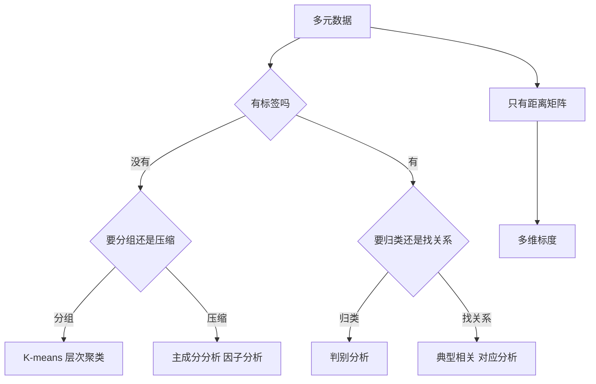

# 第 10 章：多元分析

- **难度**：★★★ | **预估学时**：8 小时 | **前置**：第 7 章 | **原书定位**：第 10 章 p262–354

## 学习目标

学完本章，你能：

- 分清聚类、降维、判别、相关分析各自解决什么问题；
- 手算一次 K-means 的两轮迭代；
- 说清主成分分析为什么能降维，以及主成分不能怎么解释。

## 一句话核心

多元分析的七种方法，本质是四件事：把样本分组、把变量压缩、把样本归类、把两组变量联系起来。

## 零基础讲解

### 概念 1：聚类（难度：基础）

**聚类**：没有标签，只按相似度把样本分组。

- **K-means**：先定 k 个中心，把每个点分给最近的中心，再按组内均值更新中心，反复直到中心不动。要求先给定 k，对初值敏感。
- **层次聚类**：每次合并最近的两类，得到一棵树（树状图），按需要切一刀决定类数。不需要预先定 k，但计算量大。

手算例子：一维数据 1、2、8、9，k = 2。初始中心取 1 和 8：分组 {1,2} 与 {8,9}；新中心 1.5 与 8.5；再分组仍是 {1,2}、{8,9}，收敛。若初始中心取 2 和 9，结果相同；但数据换成 1、5、6、9 时，初值不同可能得到不同分组，所以要多次随机初始化。

### 概念 2：主成分分析（难度：进阶）

**主成分分析（PCA）**：把原始变量线性组合成少数几个互不相关的新变量，尽量保留原有变异。

步骤：标准化 → 算协方差矩阵 → 求特征值与特征向量 → 按特征值从大到小排序 → 取前 k 个。

**贡献率** = 某个特征值 / 特征值总和。取累计贡献率 85% 以上通常够用。

关键限制：主成分是数学构造，未必有物理含义。说「第一主成分代表综合实力」需要额外证据，不能只因为载荷都为正。

### 概念 3：判别分析（难度：进阶）

**判别分析**：有标签，建立从变量到类别的判别函数，用来给新样本归类。与聚类相反，它先知道类别再学规则。

常用：线性判别（LDA）、距离判别、贝叶斯判别。评估看错判率与交叉验证准确率。

### 概念 4：因子分析与典型相关（难度：高难）

- **因子分析**：假设观测变量由少数潜在因子加误差生成，用来找「看不见的原因」。与 PCA 的区别是它有模型假设，PCA 只是变换。
- **典型相关分析**：找两组变量各自的线性组合，使这两组的相关系数最大。用于「一组自变量与一组因变量」的整体关系。
- **对应分析**：处理分类变量的列联表，把行与列画在同一张图上。

### 概念 5：多维标度（难度：高难）

**多维标度（MDS）**：只给样本间的距离矩阵，反推出低维坐标，使坐标间距离尽量还原原始距离。用于心理测量、气味图谱这类「只有相似度、没有坐标」的数据。

## 图示

看图说明：第一个判断是「有没有标签」，这一步错了，方法全错。聚类和判别最容易混，记住：聚类无标签，判别有标签。

## 类比与实例

- **类比**：PCA 像把一摞不同角度的照片压成一张正面照，保留轮廓、丢掉侧面细节。失效边界：如果物体的关键特征恰好在被丢掉的方向上，压缩后的照片就认不出它。
- **实例（可核算）**：三个样本在两个指标上的值为 (1,1)、(2,2)、(3,3)。两个变量完全相关，PCA 第一主成分方向为 (1,1)/√2，投影值 1.414、2.828、4.243，贡献率 100%，第二主成分为 0。这说明当变量完全共线时，一个主成分就够了。

## 常见误解

- 别以为聚类结果一定有意义——实际上算法只按距离分组，分出的类可能完全没有业务含义。
- 别以为主成分可以随意命名——实际上命名需要载荷分析与领域知识支撑。
- 别以为判别分析能替代因果分析——实际上它只给分类规则，不解释为什么。

## 自测题（答案与解析）

### Q1 【单选】K-means 必须预先确定的是？
- A. 距离度量
- B. 聚类数 k
- C. 特征个数
- D. 样本标签
**答案**：B
**解析**：k 是超参数，通常用肘部法或轮廓系数辅助选择。

### Q2 【单选】PCA 中「贡献率」指的是？
- A. 某个样本的解释比例
- B. 某主成分特征值占全部特征值之和的比例
- C. 分类准确率
- D. 变量个数占比
**答案**：B
**解析**：特征值代表该方向上的方差，占比即该主成分保留的信息比例。

### Q3 【填空】有标签、要给新样本归类的分析叫________分析。
**答案**：判别
**解析**：判别分析先学类别再分类；聚类没有标签。

## 复习锚点

- 无标签分组用聚类，有标签归类用判别。
- PCA 保留方差大的方向，主成分未必可解释。
- 因子分析有模型假设，PCA 只是线性变换。
