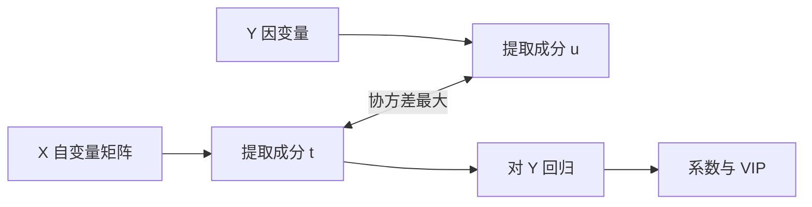

# 第 11 章：偏最小二乘回归分析

- **难度**：★★★ | **预估学时**：4 小时 | **前置**：第 7 章、第 10 章 | **原书定位**：第 11 章 p355–366

## 学习目标

学完本章，你能：

- 判断一份数据是否有多重共线性，以及它为什么让回归系数失控；
- 说清偏最小二乘与主成分回归的区别；
- 解释「提取几个成分」该怎么定。

## 一句话核心

当自变量彼此高度相关时，普通最小二乘会给出方向乱跳的系数；偏最小二乘改成「边压缩边找与因变量最相关的方向」。

## 零基础讲解

### 概念 1：多重共线性（难度：进阶）

**多重共线性**：自变量之间近似线性相关。比如 x₂ ≈ x₁ + 少量噪声。

后果：系数估计方差极大，数据动一点系数就翻号。经济解释变成「投资增加、消费减少」，明明两者同向变化。

诊断：方差膨胀因子 VIF > 10，或相关矩阵里有接近 ±1 的元素，或条件数很大。

### 概念 2：偏最小二乘的思路（难度：进阶）

**偏最小二乘（PLS）**：从自变量 X 中提取若干成分 t₁, t₂, …，同时从因变量 Y 中提取成分 u₁, u₂, …，要求 t 与 u 的协方差最大，再用 t 对 Y 回归。

与 PCA 的关键差别：PCA 只看 X 的方差最大的方向，不管它和 Y 有没有关系；PLS 同时看 X 的变异与 X–Y 的相关，所以提取的方向更「有用」。

### 概念 3：NIPALS 迭代（难度：高难）

每一步做四件事：

1. 用 X 与 Y 的协方差挑出权重 w；
2. 算成分 t = Xw，归一化；
3. 用 t 回归 X 与 Y，得到载荷 p 与 q；
4. 从 X、Y 中减去已被解释的部分（收缩），再重复。

停止条件：交叉验证的预测误差不再下降。成分太少欠拟合，太多等于回到普通回归。

### 概念 4：结果怎么读（难度：进阶）

- **载荷图**：看哪些变量在同一个成分上载荷大，说明它们共同驱动这个方向。
- **VIP 值**：变量重要性投影，VIP > 1 通常算重要变量。
- **回归系数**：PLS 最终也给出系数，但它是在成分空间里算的，解释时要结合载荷。

## 图示

看图说明：中间那条双向箭头是 PLS 与 PCA 的分水岭。只从 X 提取、不看 Y 的，是 PCA；两边一起看的，是 PLS。

## 类比与实例

- **类比**：PLS 像挑助手，不只看谁本事大，还看谁跟你手头的活最搭。PCA 只挑本事最大的，可能挑来的人帮不上忙。失效边界：如果活儿本身不需要那么多人，PLS 也会过拟合，成分数要靠交叉验证压住。
- **实例（可核算）**：若 x₂ = x₁ + 0.01ε，普通回归的系数会在 (100, −99) 附近剧烈摆动，两个变量单独看都显著，合起来却互相抵消。PLS 会把它们合并成一个成分，系数稳定，但代价是失去「哪一个更重要」的区分能力。

## 常见误解

- 别以为共线性只影响显著性——实际上它首先破坏的是系数的可解释性。
- 别以为 PLS 能替代变量筛选——实际上它把相关变量打包，不会告诉你该删哪个。
- 别以为成分越多越好——实际上成分数超过必要值，模型会重新变得不稳定。

## 自测题（答案与解析）

### Q1 【单选】多重共线性的典型后果是？
- A. 模型无法求解
- B. 回归系数方差变大、符号可能反常
- C. R² 一定下降
- D. 样本量自动减少
**答案**：B
**解析**：共线让设计矩阵接近奇异，系数估计对数据扰动极度敏感。

### Q2 【单选】PLS 与 PCA 的核心区别是？
- A. PLS 不做降维
- B. PLS 提取成分时同时考虑与 Y 的相关
- C. PCA 只能用于分类
- D. PLS 不需要数据
**答案**：B
**解析**：PCA 只看 X 的方差，PLS 看 X 与 Y 的协方差。

### Q3 【填空】判断变量重要性常用指标是________值，通常大于 1 视为重要。
**答案**：VIP
**解析**：VIP 综合了各成分对 Y 的解释力与变量在成分上的载荷。

## 复习锚点

- 共线性先毁系数可解释性，再毁显著性。
- PLS 同时看 X 的变异与 X–Y 相关。
- 成分数由交叉验证定，不是越多越好。
