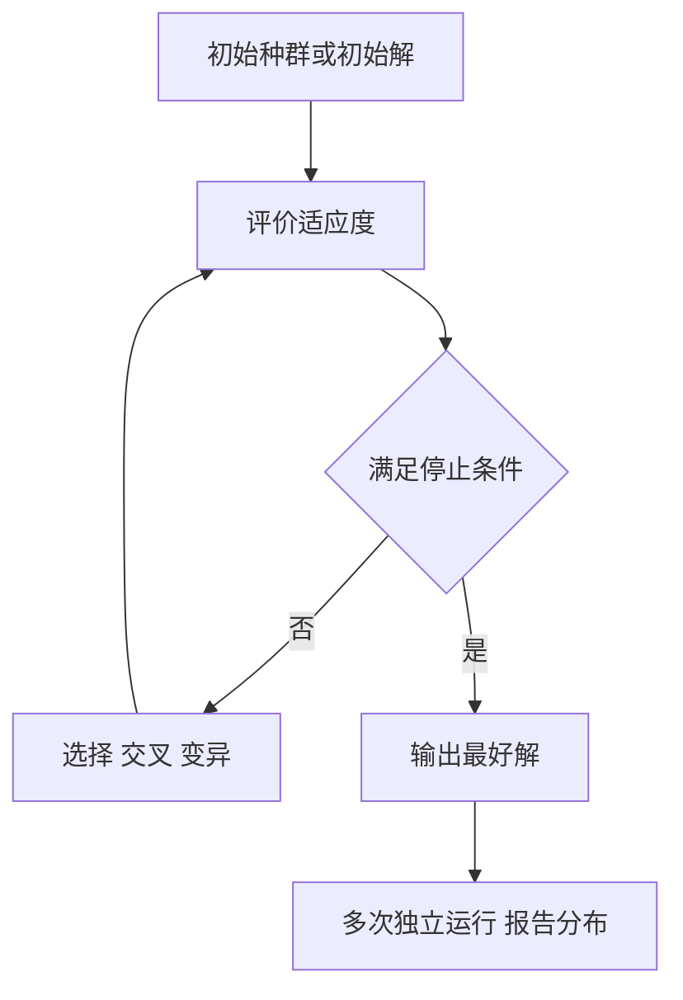

# 第 12 章：现代优化算法

- **难度**：★★☆ | **预估学时**：5 小时 | **前置**：第 2–4 章 | **原书定位**：第 12 章 p367–382

## 学习目标

学完本章，你能：

- 说清什么时候必须放弃精确算法、改用启发式；
- 手写模拟退火的接受概率，并解释温度的作用；
- 设计一个遗传算法的编码、适应度、选择、交叉、变异五件套。

## 一句话核心

启发式算法不保证最优，它保证在有限时间里给你一个能用的解——所以论文里必须报告「跑了多少次、最好结果多少、波动多大」。

## 零基础讲解

### 概念 1：为什么需要启发式（难度：基础）

TSP、大规模选址、排班这类问题是 NP 难的，点数一多，精确算法跑不完。启发式牺牲最优性换时间。

判断标准：问题规模超过精确算法能处理的范围（比如 TSP 超过 20 个点），或目标函数不可导、含整数与逻辑约束。

### 概念 2：模拟退火（难度：进阶）

**模拟退火（SA）**：从当前解出发随机扰动，新解更好就接受，更差也按概率接受。

接受概率：

```text
P = exp(−Δ/T)
```

Δ 是目标函数变差量，T 是温度。T 高时几乎什么都接受，T 低时只接受更好的解。

流程：初始温度 T₀ → 迭代若干次 → 按降温系数 α（如 0.95）降温 → 到终止温度停止。每个温度下要迭代足够多次，否则退火变成随机游走。

### 概念 3：遗传算法（难度：进阶）

**遗传算法（GA）**：把解编码成染色体，用适应度评价，通过选择、交叉、变异产生下一代。

五件套：

1. **编码**：0-1 串、整数串、实数串。TSP 用路径序列编码。
2. **适应度**：目标函数转成正值，越大越好。
3. **选择**：轮盘赌或锦标赛，适应度高的更容易被选中。
4. **交叉**：交换片段。TSP 要用顺序交叉，避免出现重复城市。
5. **变异**：随机改动一位，保持多样性。

参数：种群规模 50–200，交叉率 0.7–0.9，变异率 0.01–0.1。参数没有普适最优，要按问题调。

### 概念 4：改进与评估（难度：进阶）

- **精英保留**：每代把最好的几个个体直接复制到下一代，防止退化。
- **自适应变异率**：适应度高的个体变异率低，低的个体变异率高。
- **多种群**：几个子种群独立进化，定期交流，缓解早熟。

评估必须报告：运行次数（如 20 次独立运行）、最好值、平均值、标准差。只报一次最好结果，等于没说。

## 图示



看图说明：注意最后一步在循环之外。它不是算法的一部分，但少了它，结果的可信度没法评估。

## 类比与实例

- **类比**：退火像往山坡上扔球再让它慢慢停在低处，温度高时球能弹过小坑，温度低时只能往下滚。失效边界：如果地形有巨大的深坑隔开，球仍可能停在错的坑里，这时要多起点。
- **实例（可核算）**：4 城市距离矩阵对称，A-B 2、A-C 6、A-D 5、B-C 3、B-D 4、C-D 7。遍历路线 A-B-C-D-A 长 2+3+7+5 = 17；A-B-D-C-A 长 2+4+7+6 = 19；A-C-B-D-A 长 6+3+4+5 = 18。最优是 17。启发式跑 20 次，若 18 次得 17、2 次得 18，就说明算法稳定但不保证每次都最优。

## 常见误解

- 别以为启发式不需要建模——实际上编码方式和邻域结构决定搜索能力，这部分比调参重要。
- 别以为跑出好结果就万事大吉——实际上不复现、不报告分布，结果无法采信。
- 别以为参数越大越好——实际种群过大拖慢收敛，温度过高等于乱搜。

## 自测题（答案与解析）

### Q1 【单选】模拟退火中温度 T 的主要作用是？
- A. 控制迭代次数
- B. 控制接受较差解的概率
- C. 决定编码长度
- D. 计算适应度
**答案**：B
**解析**：P = exp(−Δ/T)，T 越大越容易接受差解，用于跳出局部最优。

### Q2 【单选】TSP 使用遗传算法时，普通交叉会导致？
- A. 收敛过快
- B. 路径中出现重复或缺失城市
- C. 适应度无法计算
- D. 种群规模爆炸
**答案**：B
**解析**：普通单点交叉会重复片段，必须用顺序交叉等保序算子。

### Q3 【填空】启发式算法论文必须报告多次独立运行的________，而不只是最好值。
**答案**：分布（平均值与标准差）
**解析**：单次结果无法区分「算法稳定」与「运气好」。

## 复习锚点

- 规模超限或目标不可导时，才换启发式。
- 退火靠温度控制接受差解的概率。
- GA 五件套：编码、适应度、选择、交叉、变异。
- 结果要报多次运行的分布。
