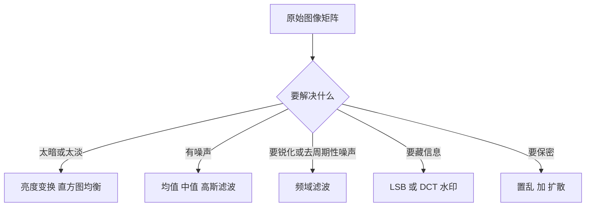

# 第 13 章：数字图像处理

- **难度**：★★☆ | **预估学时**：4 小时 | **前置**：第 5 章、起步册第 2 章 | **原书定位**：第 13 章 p383–409

## 学习目标

学完本章，你能：

- 说清一幅数字图像在计算机里到底是什么；
- 手算一次 3×3 均值滤波，看出它为什么能去噪也会糊边；
- 分清空间域与频域两种做法的适用场景。

## 一句话核心

图像是矩阵，处理图像就是对这个矩阵做局部加权平均、变换或编码。

## 零基础讲解

### 概念 1：图像是矩阵（难度：基础）

**灰度图**：每个像素一个 0–255 的数，0 黑 255 白。整幅图就是一个 m×n 矩阵。

**彩色图**：三个通道 R、G、B，每个通道一个矩阵，形状 m×n×3。

**灰度化**：把三通道合成一个，常用加权 Y = 0.299R + 0.587G + 0.114B。权重不同是因为人眼对绿光最敏感。

### 概念 2：亮度变换（难度：基础）

- **线性拉伸**：把原本集中在 100–150 的灰度拉到 0–255，对比度立刻变强。
- **伽马变换**：s = c·r^γ，γ < 1 提亮暗部，γ > 1 压暗。
- **直方图均衡**：按累计分布重新分配灰度，使直方图尽量平坦。全局提对比，但可能放大噪声。

### 概念 3：空间滤波（难度：进阶）

**空间滤波**：拿一个小窗口（如 3×3）在图上滑动，每个位置算一个加权和，写回中心像素。

均值滤波的核是所有权重都为 1/9。手算一个例子：

```text
10  10  10
10  10  10
10  10  90
```

中心像素原值 10，窗口和 = 10×8 + 90 = 170，除以 9 得 18.9，取整 19。原来那个 90 的亮点被压到 19，噪声减弱；同时如果 90 是真实边缘，边缘也被抹平。

中值滤波取窗口中位数，上例中位数是 10，比均值更能保住边缘。椒盐噪声首选它。

### 概念 4：频域处理（难度：进阶）

**傅里叶变换**把图像从空间域变到频域：低频对应大块平滑区域，高频对应边缘与噪声。

低通滤波（保留低频）去噪但模糊；高通滤波（保留高频）锐化但放大噪声。频域做法的好处是「滤波器的设计直观」，代价是要做正反两次变换。

### 概念 5：水印与加密（难度：高难）

- **LSB 水印**：把水印信息写进像素值的最低位。人眼看不出来，但压缩或裁剪会破坏。
- **DCT 水印**：在频域中频系数里嵌入，抗压缩能力强。
- **图像加密**：Arnold 置乱打乱像素位置，混沌序列异或改变像素值。两者叠加才算安全，只置乱不改变直方图，容易被统计分析破解。

## 图示



看图说明：先明确目的再选工具。去噪选错滤波器，会把该保留的边缘一起抹掉。

## 类比与实例

- **类比**：均值滤波像给照片蒙一层毛玻璃，颗粒感没了，细节也糊了。失效边界：毛玻璃是均匀模糊，均值滤波在边缘处会产生「拖影」，方向性噪声用它反而更糟。
- **实例（可核算）**：上面那个 3×3 窗口，若改用中值滤波，排序后中间值是 10，输出 10，亮点被完全剔除；若用最大值滤波，输出 90，亮点保留。同一窗口，三种滤波三种结果，说明「滤波」不是单一操作。

## 常见误解

- 别以为分辨率越高信息越多——实际上压缩、模糊、噪声都会让高分辨率图的有效信息变少。
- 别以为滤波一定让图更好看——实际上过度平滑会让边缘消失，后续识别精度下降。
- 别以为 LSB 水印很安全——实际上任何有损压缩都能把它抹掉。

## 自测题（答案与解析）

### Q1 【单选】灰度化时绿色通道权重最大的原因是？
- A. 绿色像素最多
- B. 人眼对绿光最敏感
- C. 绿色通道噪声最小
- D. 计算方便
**答案**：B
**解析**：加权系数按人眼亮度感知设定，绿光权重 0.587 最高。

### Q2 【单选】椒盐噪声最适合用哪种滤波？
- A. 均值滤波
- B. 中值滤波
- C. 高通滤波
- D. 直方图均衡
**答案**：B
**解析**：中值滤波能剔除极端值同时保住边缘，均值会把噪声摊到整片区域。

### Q3 【填空】3×3 均值滤波窗口中，每个位置的权重是________。
**答案**：1/9
**解析**：九个像素等权平均，总和为 1，保证整体亮度不漂移。

## 复习锚点

- 图像就是矩阵，处理就是矩阵运算。
- 均值去噪糊边，中值保边去椒盐。
- 频域低通去噪、高通锐化，各管一头。
