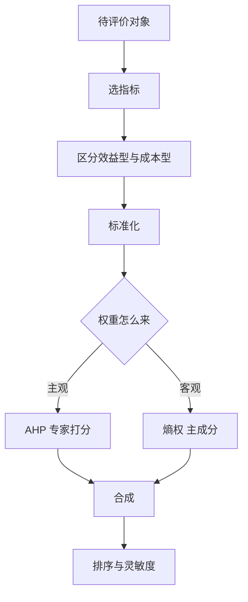

# 第 14 章：综合评价与决策方法

- **难度**：★★☆ | **预估学时**：7 小时 | **前置**：第 7 章、第 10 章 | **原书定位**：第 14 章 p410–447

## 学习目标

学完本章，你能：

- 把「哪个方案更好」拆成指标、权重、标准化、合成四步；
- 手算一次极差标准化与加权合成，看出权重如何改变排序；
- 说清 TOPSIS、熵权法、模糊综合评判各自的前提。

## 一句话核心

综合评价没有绝对正确，只有「口径说清楚了、权重交代了、结论能复现」的排序。

## 零基础讲解

### 概念 1：四步流程（难度：基础）

1. **定指标**：选能测、能比的量，分清效益型（越大越好）与成本型（越小越好）。
2. **标准化**：把不同量纲拉到同一区间。常用极差法：效益型 (x − min)/(max − min)，成本型 (max − x)/(max − min)。
3. **定权重**：主观（专家打分、AHP）或客观（熵权、主成分）。
4. **合成排序**：加权求和，或算与理想解的距离。

### 概念 2：手算一个排序（难度：基础）

三个方案，价格 20、25、30 万元（成本型），质量评分 80、90、85（效益型）。

价格标准化：(30 − x)/10 → 1、0.5、0。
质量标准化：(x − 80)/10 → 0、1、0.5。

权重各 0.5：得分 0.5、0.75、0.25，方案 2 最好。
权重改成价格 0.8、质量 0.2：得分 0.8、0.6、0.1，方案 1 最好。

同一组数据，换个权重排序就翻。这不是方法不稳，而是「哪个更重要」本来就是决策者的判断。论文里必须写清权重来源，并做权重灵敏度。

### 概念 3：TOPSIS（难度：进阶）

**理想解法（TOPSIS）**：先构造正理想解（每个指标都取最好）与负理想解（每个都取最差），再算每个方案到两者的欧氏距离，离正理想近、离负理想远的排前面。

优点：不要求指标独立，排序结果对权重不那么敏感。缺点：距离用的是欧氏距离，指标相关性高时会重复计权。

### 概念 4：熵权法（难度：进阶）

**熵权法**：指标在方案间差异越大，信息量越大，权重越高。

步骤：标准化 → 算比重 pᵢⱼ → 算熵 eⱼ = −(1/ln n)∑pᵢⱼln pᵢⱼ → 权重 wⱼ = (1 − eⱼ)/∑(1 − eⱼ)。

注意：熵权是客观权重，它不代表重要性，只代表区分度。某项指标所有方案都一样，熵权为 0，但它可能极其重要——这是熵权法最大的坑。

### 概念 5：其他方法一句话（难度：进阶）

| 方法 | 一句话 | 前提 |
|---|---|---|
| 模糊综合评判 | 用隶属度处理「说不太清」的评价 | 要构造合理的隶属函数 |
| 数据包络分析 DEA | 用投入产出比评价效率 | 决策单元要同类、指标非负 |
| 灰色关联分析 | 看序列形状相似度 | 数据少也能用，但分辨率有限 |
| 秩和比 RSR | 用秩次合成，抗异常值 | 会丢失原始数值信息 |
| 主成分分析 | 用少数综合成分排序 | 成分要有可解释性 |
| PageRank | 用链接关系给节点排序 | 要有有向关系网络 |

## 图示

看图说明：权重来源是整章分歧最大的地方。主观权重可解释但可被质疑，客观权重可复现但可能背离业务重要性，稳妥做法是两种都算、对比结果。

## 类比与实例

- **类比**：综合评价像给几个候选人打分录取，指标是分数项，权重是各科占比。失效边界：录取只看排序，评价常常还要给「为什么」，光有排名不够。
- **实例（可核算）**：上例三方案，若改用熵权法：价格标准化值 1、0.5、0 的差异大，熵小、权重大；质量 0、1、0.5 差异也大。两者熵接近，权重接近 0.5，结果与等权相同。这说明熵权并不自动偏向「更重要的指标」。

## 常见误解

- 别以为指标越多越全面——实际上指标相关性高会重复计权，反而失真。
- 别以为客观权重比主观权重科学——实际上熵权只看区分度，不看业务重要性。
- 别以为排序稳定就说明方法好——实际上可能只是权重给得接近平均。

## 自测题（答案与解析）

### Q1 【单选】成本型指标标准化时应该？
- A. 直接除以最大值
- B. 用 (max − x)/(max − min)
- C. 取对数
- D. 平方后归一
**答案**：B
**解析**：成本型越小越好，极差法要反向，使标准化后仍是越大越好。

### Q2 【单选】熵权法的权重反映的是？
- A. 指标的业务重要性
- B. 指标在方案间的区分度
- C. 指标间的相关性
- D. 样本量大小
**答案**：B
**解析**：熵小说明分布不均、区分度大，权重高；与重要性无必然关系。

### Q3 【填空】TOPSIS 通过计算方案到正理想解与负理想解的________来排序。
**答案**：距离
**解析**：离正理想越近、离负理想越远，综合得分越高。

## 复习锚点

- 评价四步：指标、标准化、权重、合成。
- 权重换一换，排序可能翻，必须做灵敏度。
- 熵权看区分度，不看重要性。
