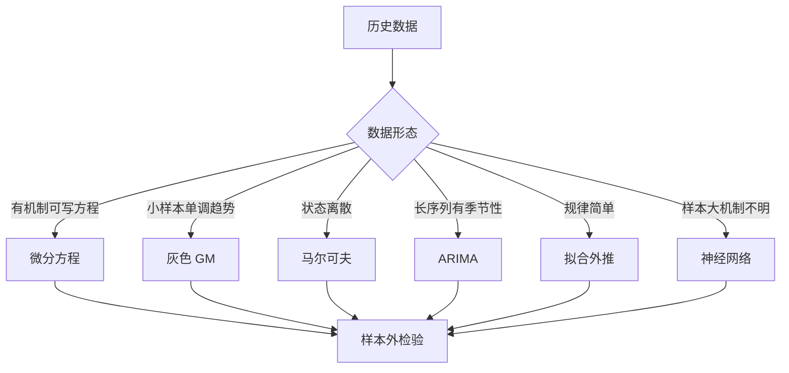

# 第 15 章：预测方法

- **难度**：★★★ | **预估学时**：7 小时 | **前置**：第 6、7 章 | **原书定位**：第 15 章 p448–477

## 学习目标

学完本章，你能：

- 按数据形态选预测方法：有机制、有趋势、有周期、有状态转移；
- 手算 GM(1,1) 的两步预测，并解释为什么它适合小样本；
- 说清「预测精度」该怎么报，为什么不能只报一个点估计。

## 一句话核心

预测方法的差别不在算法新旧，而在它假设数据由什么驱动。

## 零基础讲解

### 概念 1：六类方法与它们的假设（难度：基础）

| 方法 | 假设数据由什么驱动 | 适用场景 |
|---|---|---|
| 微分方程 | 有明确的机制与反馈 | 传染病、人口、反应过程 |
| 灰色 GM(1,1) | 累加后近似指数增长 | 小样本、单调趋势 |
| 马尔可夫 | 下一状态只依赖当前状态 | 状态离散、转移概率稳定 |
| 时间序列 ARIMA | 趋势 + 差分平稳 + 自相关 | 有历史序列、季节性 |
| 插值与拟合 | 趋势平滑可外推 | 数据点少、规律简单 |
| 神经网络 | 非线性映射关系 | 样本多、机制不明 |

选错假设，再精细的参数也救不回来。比如用线性外推预测疫情早期，会低估指数增长。

### 概念 2：GM(1,1) 手算（难度：进阶）

原始序列 x⁰ = (2, 3, 4)，做一次累加得 x¹ = (2, 5, 9)。

级比检验：λ(2) = 2/3 = 0.667，λ(3) = 3/4 = 0.75。n = 3 时容许区间约为 (0.607, 1.649)，两个比值都落在区间内，可以用 GM(1,1)。

构造矩阵：紧邻均值 z = (3.5, 7)，B = [[−3.5, 1], [−7, 1]]，Y = [[3], [4]]。

最小二乘解 (BᵀB)⁻¹BᵀY 得 a = −0.2857，b = 2。

预测式：x̂¹(k+1) = (x⁰(1) − b/a)e^(−a k) + b/a = 9 e^(0.2857k) − 7。

k = 1：x̂¹(2) = 9×1.3307 − 7 = 4.98。
k = 2：x̂¹(3) = 9×1.7709 − 7 = 8.94。

还原：x̂⁰(3) = 8.94 − 4.98 = 3.96，与真值 4 相差 0.04，相对误差约 1%。

注意 a 为负表示增长。若 a 为正，说明序列在衰减，模型形式仍成立，但预测会递减。

### 概念 3：马尔可夫与时间序列（难度：进阶）

**马尔可夫链**：状态集合 + 转移概率矩阵。下一期状态只由本期状态决定，与更早的历史无关。

用法：统计历史转移频次得矩阵 P，下一期分布 = 本期分布 × P。要求样本足够估计转移概率，且过程近似平稳。

**ARIMA(p,d,q)**：p 是自回归阶数，d 是差分次数，q 是移动平均阶数。先做单位根检验确定 d，再看 ACF/PACF 定 p、q，最后用 AIC 选模型。

### 概念 4：精度怎么报（难度：进阶）

三个指标：MAE 平均绝对误差、RMSE 均方根误差、MAPE 平均绝对百分比误差。

必须做**样本外检验**：留出最后若干期不参与建模，用它们评估。样本内拟合得好，不代表预测得准。

只报一个预测值而不给区间，等于隐藏不确定性。区间可以用残差标准差估，也可以用 Bootstrap。

## 图示

看图说明：六条路径最后都汇到「样本外检验」。这一步省掉，方法再花哨也没有可信度。

## 类比与实例

- **类比**：预测像看后视镜开车，镜子里清楚，前方只能推断。失效边界：路况突变时后视镜毫无用处，这正是所有统计预测的共同弱点。
- **实例（可核算）**：某产品销量 2、3、4 万件，用 GM(1,1) 得下一期 3.96，用线性拟合（斜率 1）得 5，用二次外推得 5。三个方法差 1 万件。差异来自假设：GM 认为增长放缓，线性认为匀速，二次认为加速。论文里选哪个，要说清依据。

## 常见误解

- 别以为模型越复杂预测越准——实际上样本少时复杂模型参数估不准，简单模型更稳。
- 别以为拟合 R² 高就能预测——实际上过拟合在样本外会崩。
- 别以为预测是一个数——实际上必须给区间或误差范围。

## 自测题（答案与解析）

### Q1 【单选】GM(1,1) 适合的数据特征是？
- A. 大样本、强季节性
- B. 小样本、近似指数趋势
- C. 状态离散、转移稳定
- D. 多变量非线性
**答案**：B
**解析**：GM 通过一次累加把序列变成近似指数，适合数据点少的单调趋势。

### Q2 【单选】ARIMA 中的 d 表示？
- A. 差分次数
- B. 自回归阶数
- C. 移动平均阶数
- D. 样本量
**答案**：A
**解析**：d 是把非平稳序列差分成平稳序列所需的次数。

### Q3 【填空】评估预测精度必须做________检验，而不是只看样本内拟合。
**答案**：样本外
**解析**：样本内拟合优度高不代表泛化能力好，留出末段数据做真实验证才有意义。

## 复习锚点

- 六类预测对应六种数据假设，先判形态再选方法。
- GM(1,1) 靠累加 + 最小二乘，适合小样本。
- 精度必须报样本外指标与区间。
