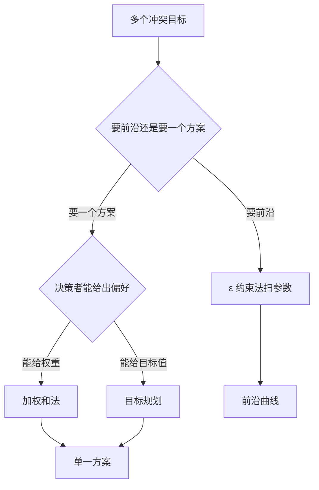

# 第 16 章：多目标规划和目标规划

- **难度**：★★★ | **预估学时**：5 小时 | **前置**：第 1–3 章 | **原书定位**：第 16 章 p478–492

## 学习目标

学完本章，你能：

- 说清多目标问题为什么没有唯一最优解；
- 用加权和法与 ε 约束法各求一个折中方案；
- 把「尽量达到某目标」写成带偏差变量的目标规划。

## 一句话核心

多目标不是「几个目标一起最大」，而是「在冲突的目标之间选一个你愿意接受的交换比例」。

## 零基础讲解

### 概念 1：Pareto 有效解（难度：基础）

**Pareto 有效解**：找不到另一个解在所有目标上都不差、且至少一个目标更好。也叫非劣解。

例：五个方案的目标值为 (1,5)、(2,4)、(3,3)、(4,2)、(5,1)，都在直线 x + y = 6 上，互相无法全面超越，都是有效解。而 (2,3) 被 (3,3) 全面超越（第一目标更高、第二目标相同），是劣解。

多目标优化的输出不是一个点，而是一条**Pareto 前沿**。选哪一点，是决策，不是计算。

### 概念 2：加权和法（难度：基础）

把多个目标加权成一个大目标：max w₁f₁ + w₂f₂，w₁ + w₂ = 1。

优点：简单，一次求解。缺点：权重不同结果不同，且当目标量纲差很多时，权重要先归一化。

坑：如果 Pareto 前沿不是凸的，加权和法会漏掉中间的解——它只能取到支撑点。

### 概念 3：ε 约束法（难度：进阶）

把一个目标作为主目标，其余目标改成约束：max f₁，s.t. f₂ ≥ ε₂, f₃ ≥ ε₃。

扫 ε 从大到小，得到一串解，构成前沿。优点是非凸前沿也能取到；缺点是要反复求解，且 ε 的可行范围要试。

### 概念 4：目标规划（难度：进阶）

**目标规划**：不追求最大最小，而是「尽量接近给定目标值」。

引入偏差变量 d⁺（超出量）与 d⁻（不足量），满足 f(x) + d⁻ − d⁺ = 目标值，d⁺, d⁻ ≥ 0，目标是最小化加权偏差。

优先级：先保证第一级目标，再在它的最优解集里优化第二级。这叫**分层目标规划**。

例：利润目标 120（千元），用工上限 80（工时）。约束写成 3x + 2y + d₁⁻ − d₁⁺ = 120；x + y + d₂⁻ = 80。目标 min 5d₁⁻ + 3d₂⁻。系数 5 与 3 表示「利润差 1 千元比用工差 1 工时更严重」。

## 图示

看图说明：先问「要一条线还是一个点」。这是多目标建模最先要问清的问题，答错了后面全白做。

## 类比与实例

- **类比**：多目标像买电脑时在性能与续航之间权衡。没有「最好」的电脑，只有「按你的用法最合适」的电脑。失效边界：电脑还能加钱两样都要，多目标问题里资源固定，加钱这个选项不存在。
- **实例（可核算）**：某厂两目标 f₁ = 4x + 3y（利润），f₂ = x + 2y（市场份额），约束 2x + y ≤ 10、x + y ≤ 8、x,y ≥ 0。加权 w = 0.5：max 2.5x + 2.5y，沿 x + y = 8 取到，值 20，解不唯一——这说明权重相等时问题退化。改用 w₁ = 0.7、w₂ = 0.3：max 3.1x + 2.7y，最优在 (2,6)，得 6.2 + 16.2 = 22.4；对比 (1,7) 得 3.1 + 18.9 = 22.0，前者更优。

## 常见误解

- 别以为多目标可以「全部最大化」——实际上目标冲突时不存在这样的解。
- 别以为加权和法一定找到最优折中——实际上非凸前沿会漏解。
- 别以为目标规划就是多目标规划——实际上它把目标变成约束，优化的是偏差。

## 自测题（答案与解析）

### Q1 【单选】Pareto 有效解的含义是？
- A. 所有目标都最大
- B. 不存在全面更优的解
- C. 加权和最大的解
- D. 约束最少的解
**答案**：B
**解析**：有效解指不被任何其他解全面超越，可能有很多个。

### Q2 【单选】加权和法的主要局限是？
- A. 不能处理两个以上目标
- B. 非凸前沿上会漏掉中间解
- C. 必须用整数规划
- D. 权重必须相等
**答案**：B
**解析**：加权和只能取到支撑点，非凸部分取不到，需改用 ε 约束法。

### Q3 【填空】目标规划中 d⁺ 表示实际值相对目标值的________量。
**答案**：超出
**解析**：d⁺ 是正偏差（超出），d⁻ 是负偏差（不足），两者不能同时非零。

## 复习锚点

- 多目标输出前沿，不输出单点。
- 加权和简单但漏非凸解，ε 约束更全但更慢。
- 目标规划把目标写成约束，最小化偏差。
