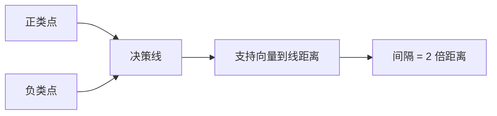

# 间隔与支持向量

<!--chapters: ch09-->

- **难度**：进阶 | **涉及章节**：第 9 章

## 一句话定义

间隔是两类点之间的安全距离；支持向量是决定这条边界的那几个最近的点。

## 为什么重要

它解释了 SVM 为什么比「随便找条线分开」更稳：间隔是模型的容错空间。

## 图示

## 详解

规范化后支持向量满足 wᵀx + b = ±1，间隔 2/‖w‖。最大化间隔等价于最小化 ‖w‖²/2，这是个二次规划。

类比：在两排人之间画线，要求离两边都尽量远，谁稍微动一下都不会越界。失效边界：两排人本身交错时无法做到，只能允许越界，即软间隔。

## 常见误解

别以为所有样本都影响边界——实际上只有支持向量进入约束等号，其余点删掉不影响结果。

## 在书中出现的脉络

| 章节 | 语境 | 关键结论 |
|---|---|---|
| 第 9 章 | 基本模型 | 间隔 2/‖w‖，支持向量定边界 |
| 第 9 章 | 软间隔 | C 控制容忍度 |

## 相关概念

- 前置：二次规划、KKT
- 后续：核函数、多分类
