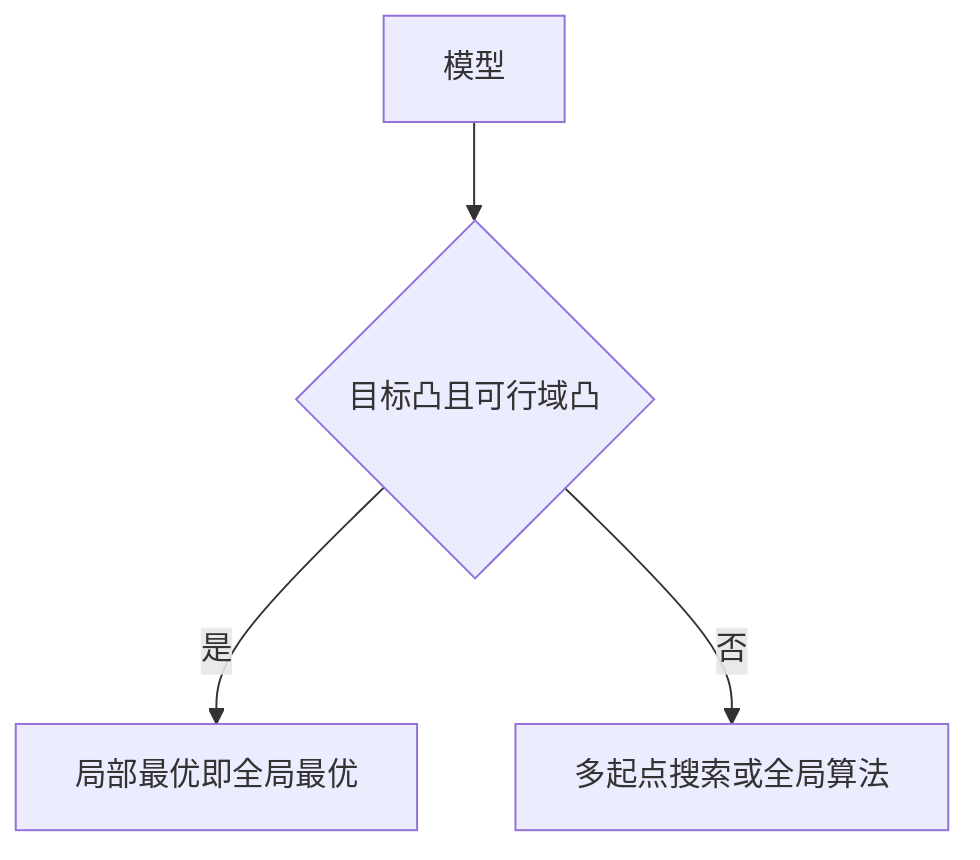

# 凸性

<!--chapters: ch03,ch10,ch16-->

- **难度**：进阶 | **涉及章节**：第 3、10、16 章

## 一句话定义

碗形结构：集合里任意两点的连线仍在集合内，函数上任意两点的连线仍在函数上方。

## 为什么重要

凸性决定算法能不能保证全局最优。凸问题用梯度法一次就能收敛到最优；非凸问题必须多起点，且每次结果可能不同。

## 图示

## 详解

判定：一元看二阶导数 ≥ 0；多元看海森矩阵半正定；可行域由线性约束构成时必凸，含等式非线性约束时要单独检查。

类比：凸像碗，球滚下去一定到碗底；非凸像山地，球可能停在小坑。失效边界：碗底也可能是一条平底槽，这时最优解不唯一，但仍是全局最优。

## 常见误解

别以为约束是线性的就一定凸——实际上目标函数非凸时整体仍非凸。

## 在书中出现的脉络

| 章节 | 语境 | 关键结论 |
|---|---|---|
| 第 3 章 | KKT 与二次规划 | 半正定 Hessian 保证凸 |
| 第 10 章 | PCA | 协方差矩阵半正定，主成分方向唯一 |
| 第 16 章 | 加权和 | 非凸前沿导致漏解 |

## 相关概念

- 前置：导数、矩阵
- 后续：KKT 条件、Pareto 前沿
