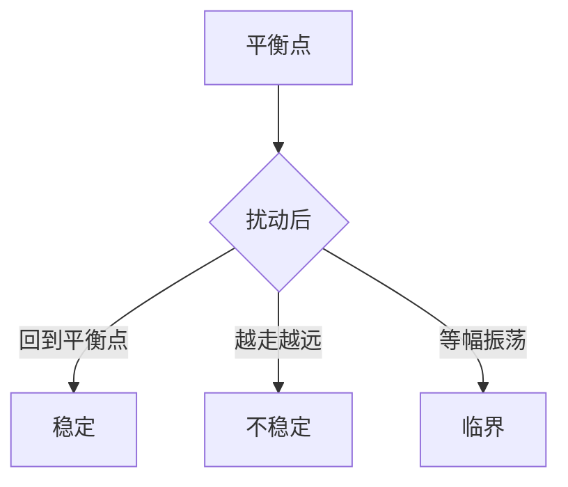

# 稳定性

<!--chapters: ch06,ch08-->

- **难度**：进阶 | **涉及章节**：第 6、8 章

## 一句话定义

初值受到小扰动后，系统会不会自己回到原来的平衡状态。

## 为什么重要

预测类模型最怕「参数差一点，结果差很多」。稳定性分析告诉你模型能用多久、误差会不会放大。

## 图示

## 详解

离散系统看特征根的模是否小于 1；连续系统看特征值实部是否为负。一阶差分 xₙ₊₁ = axₙ + b 的判据是 |a| < 1。

类比：不倒翁被推一下会晃回来，是稳定；鸡蛋立起来被碰一下就倒，是不稳定。失效边界：不倒翁只在平地稳定，斜坡上照样滚走，模型的稳定域也有范围。

## 常见误解

别以为平衡点存在就等于稳定——实际上很多平衡点是不稳定的，稍有偏差就发散。

## 在书中出现的脉络

| 章节 | 语境 | 关键结论 |
|---|---|---|
| 第 6 章 | 微分方程 | 特征值实部为负则渐近稳定 |
| 第 8 章 | 差分方程 | 特征根模小于 1 则稳定 |

## 相关概念

- 前置：特征值
- 后续：长期预测的可信度评估
