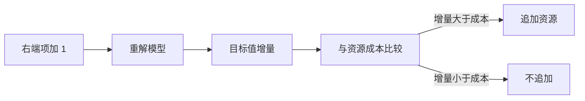

# 影子价格

<!--chapters: ch01,ch14-->

- **难度**：进阶 | **涉及章节**：第 1 章、第 14 章

## 一句话定义

某条资源约束的右端项每增加一个单位，最优目标值能提高多少。

## 为什么重要

它把「资源紧不紧」变成可比较的数字，直接支撑「要不要加班、要不要采购」这类决策。

## 图示

## 详解

对偶理论保证影子价格等于对偶变量。约束未起作用时影子价格为 0：资源闲着，再给也没用。

机床上例中 A 工时从 10 增到 11，最优值从 26 增到 27，影子价格 1 千元/小时。若加班费 0.6 千元/小时，值得加。

## 常见误解

别以为影子价格永远为正——实际上非紧约束的影子价格为 0，约束放松也不会改善目标。

## 在书中出现的脉络

| 章节 | 语境 | 关键结论 |
|---|---|---|
| 第 1 章 | 灵敏度讨论 | 影子价格 = 对偶变量 |
| 第 14 章 | 评价 | 权重可视为资源重要性的影子价格 |

## 相关概念

- 前置：线性规划、对偶
- 后续：灵敏度分析
