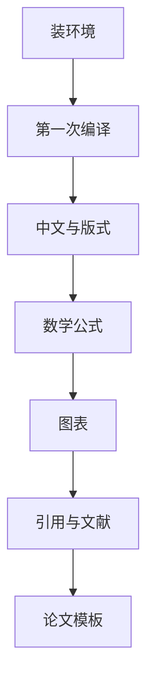

# LaTeX 入门 · 论文排版六讲

## 这一册在讲什么

刘海洋这本书 587 页，覆盖从装环境到画图、排表、做幻灯片的全部内容。但对建模比赛来说，真正要用的只有六件事：能编译、排中文、写公式、放图表、做引用、套模板。

这一册按「用得上」重排，不按原书章序。每一章都给可复制的代码，全部在 xelatex 下验证过。

## 全书心智模型

## 学习路径

| 步骤 | 章节 | 主题 | 前置 | 检查点 |
|---|---|---|---|---|
| 01 | ch01 | 环境与第一次编译 | 无 | 本地编出第一份中文 PDF |
| 02 | ch02 | 中文文档与版式 | ch01 | 能改字号、边距、页眉 |
| 03 | ch03 | 数学公式 | ch02 | 排出 align 与 cases |
| 04 | ch04 | 图表与浮动体 | ch03 | 排出三线表与子图 |
| 05 | ch05 | 目录引用与文献 | ch04 | 文献不再显示 [?] |
| 06 | ch06 | 论文模板实战 | ch05 | 四级编号正确、摘要独立成页 |

## 章节索引

- 第 1 章 环境与第一次编译（★☆☆）→ chapters/ch01-setup.md
- 第 2 章 中文文档与版式（★★☆）→ chapters/ch02-chinese-layout.md
- 第 3 章 数学公式（★★☆）→ chapters/ch03-math-formulas.md
- 第 4 章 图表与浮动体（★★☆）→ chapters/ch04-figures-tables.md
- 第 5 章 目录、交叉引用与参考文献（★★☆）→ chapters/ch05-automation.md
- 第 6 章 数模论文模板实战（★★☆）→ chapters/ch06-paper-template.md

## 前置知识

| 缺口 | 补讲位置 | 学完标志 |
|---|---|---|
| 没装过 TeX | 第 1 章 | 能跑 xelatex 出 PDF |
| 不知道 ctex 是什么 | 第 1、2 章 | 能说出中文支持来自文档类 |
| 公式只会手打 Word 公式 | 第 3 章 | 能用 align 排推导 |
| 图表总是乱跑 | 第 4 章 | 能说清浮动体规则 |
| 文献格式不会调 | 第 5 章 | 能用 gbt7714 出国标格式 |

## 入口

- 术语：glossary.md
- 抽认卡：flashcards.md
