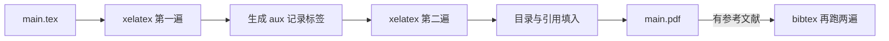

# 第 1 章：环境与第一次编译

- **难度**：★☆☆ | **预估学时**：2 小时 | **前置**：起步册第 4 章 | **原书定位**：第 1 章 p1–49

## 学习目标

学完本章，你能：

- 在本地或 Overleaf 上把一份中文文档编译成 PDF；
- 说清 xelatex、ctex、编译三遍各自解决什么问题；
- 看懂最常见的三类报错并自己修。

## 一句话核心

LaTeX 不是排版软件，它是一套「你写源码、它排版面」的工具；第一次跑通比读十页介绍有用。

## 零基础讲解

### 概念 1：发行版与编辑器（难度：基础）

**TeX 发行版**：把编译器、宏包、字体打包在一起的整体。Windows 用 TeX Live 或 MiKTeX，macOS 用 MacTeX，Linux 用 TeX Live。

**编辑器**：写源码的工具，VS Code + LaTeX Workshop 最常用，TeXstudio 传统但功能全。

**Overleaf**：在线编辑器，免安装，中文支持已内置，适合比赛时多人协作——但免费版编译有时长限制。

### 概念 2：中文要考 xelatex（难度：基础）

老教程里的 pdflatex 加 CJK 宏包已经过时。现在中文文档的标准做法是：

- 编译器用 `xelatex`；
- 文档类用 `ctexart`（文章）、`ctexrep`（报告）、`ctexbook`（书）；
- 字体用系统字体，ctex 会自动调用。

### 概念 3：最小可编译文档（难度：基础）

```latex
\documentclass[UTF8,a4paper,12pt]{ctexart}
\usepackage{amsmath,amssymb}
\usepackage{graphicx}
\usepackage{geometry}
\geometry{margin=2.5cm}

\title{第一次编译}
\author{你的名字}
\date{\today}

\begin{document}
\maketitle
\tableofcontents

\section{引言}
这是一个最小的中文文档，公式：$E = mc^2$。

\end{document}
```

保存为 `main.tex`，命令行跑 `xelatex main.tex` 两到三遍，得到 `main.pdf`。

### 概念 4：为什么要编译两三遍（难度：进阶）

第一遍生成 `.aux` 文件记录标签与页码；第二遍读 `.aux` 把交叉引用和目录填进去；有参考文献时还要跑 BibTeX，再跑两遍。

只用一遍，目录会空、引用会显示 `??`。这不是 bug，是机制。

## 图示



看图说明：箭头是单向的，但实际编译是循环：改一次源码，就要重跑整条链。VS Code 的 latexmk 会自动判断该跑几遍。

## 类比与实例

- **类比**：LaTeX 像点菜，你写菜单，厨房按标准出菜；Word 像自己下厨，边炒边调味。失效边界：菜单写错一个字，整道菜可能出不来；Word 里改一个字最多是那一页变丑。
- **实例（可动手）**：把上面例子里的 `ctexart` 改成 `article`，再用 xelatex 编译，中文会变成空白或方框。这说明中文支持来自文档类，不是来自编译器。改回来即可恢复。

## 常见误解

- 别以为报错行号就是出错行——实际上 LaTeX 的报错常滞后几行，要看第一个 `!` 号的位置，往前找。
- 别以为缺宏包要手动装——实际上 TeX Live 缺包可用 `tlmgr install 包名`，Overleaf 换文档类或改用内置宏包更快。
- 别以为 PDF 出来就算成功——实际上要检查目录、引用、公式编号、图片位置四项。

## 自测题（答案与解析）

### Q1 【单选】编译中文文档应使用哪个引擎？
- A. pdflatex
- B. xelatex
- C. latex
- D. bibtex
**答案**：B
**解析**：xelatex 原生支持 UTF-8 与系统字体，配合 ctex 文档类处理中文最稳。

### Q2 【单选】目录为空最可能的原因是？
- A. 没有写 \tableofcontents
- B. 只编译了一遍，aux 未生成
- C. 文档类不支持目录
- D. 缺少 hyperref
**答案**：B
**解析**：目录内容来自 aux 文件，需要至少两遍编译。

### Q3 【填空】TeX Live 缺宏包时，安装命令是 `tlmgr ________ 包名`。
**答案**：install
**解析**：tlmgr 是 TeX Live 的包管理器，install 后重启编辑器即可识别。

## 复习锚点

- 中文三件套：xelatex + ctex 文档类 + UTF-8。
- 编译至少两遍，有文献要加 bibtex。
- 报错看第一个 `!`，往前找几行。
