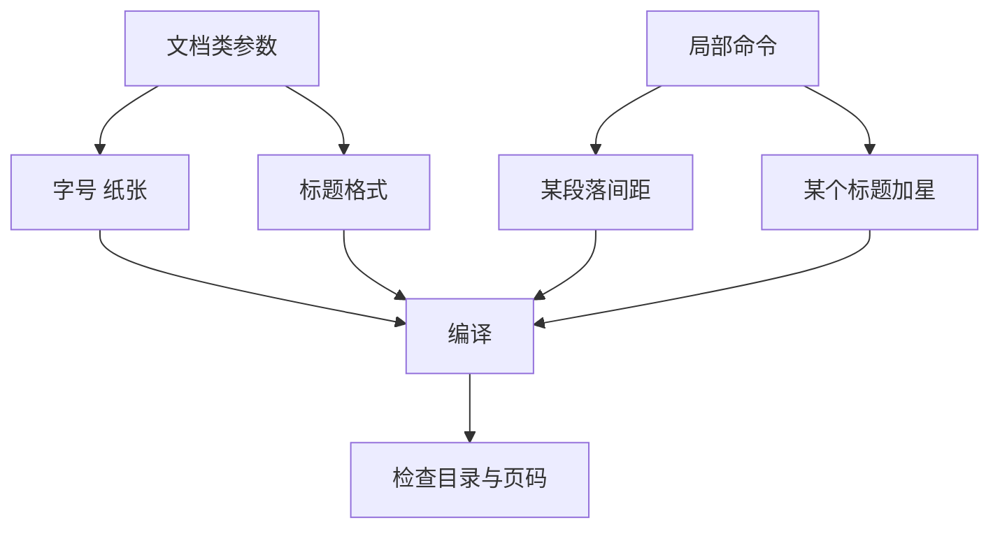

# 第 2 章：中文文档与版式

- **难度**：★★☆ | **预估学时**：3 小时 | **前置**：第 1 章 | **原书定位**：第 2 章 p50–156

## 学习目标

学完本章，你能：

- 用 geometry 改页边距，用 ctexset 改标题格式与缩进；
- 设置三级以上标题编号，并让编号出现在目录里；
- 排出一份三页以内、行距与字号都合规的中文文档。

## 一句话核心

中文排版的所有调节都落在两处：文档类参数（管全局）和局部命令（管一处），改错了位置就是白改。

## 零基础讲解

### 概念 1：页面与字号（难度：基础）

```latex
\documentclass[UTF8,a4paper,zihao=-4]{ctexart}  % -4 号字，约 12pt
\usepackage{geometry}
\geometry{top=2.5cm,bottom=2.5cm,left=3cm,right=2.5cm}
```

`zihao` 是 ctex 专有的字号参数，`-4` 表示小四。比赛论文常用小四正文、五号图表注。

行距用 `\linespread{1.3}` 放大到 1.3 倍。注意它必须在 `\begin{document}` 之前生效。

### 概念 2：标题格式与编号深度（难度：进阶）

```latex
\ctexset{
  section = {format = \Large\bfseries\centering},
  subsection = {format = \large\bfseries},
  subsubsection = {format = \normalsize\bfseries, number = \arabic{subsubsection}}
}
\setcounter{secnumdepth}{4}   % 编号到第四级
\setcounter{tocdepth}{3}      % 目录到第三级
```

`secnumdepth` 决定编号到几级，`tocdepth` 决定目录显示到几级。两者要分开设，只设一个会出现「正文有编号、目录没有」或反过来。

如果要求 `\paragraph` 也带编号，需要 `\setcounter{secnumdepth}{5}`，并给 paragraph 配 format。

### 概念 3：中英文混排（难度：基础）

- 中文与英文之间，ctex 默认不加空格，需要手写 `中文\ English` 或在导言区设 `\xeCJKsetup{CJKspace=true}` 自动加空隙。
- 英文单词不要手动断行，LaTeX 自己会断。
- 数字与单位之间用不断行空格 `~`：`10~mm`，避免「10」在行末、「mm」在行首。

### 概念 4：页眉页脚（难度：进阶）

```latex
\usepackage{fancyhdr}
\pagestyle{fancy}
\fancyhf{}
\fancyhead[C]{数学建模论文}
\fancyfoot[C]{\thepage}
\renewcommand{\headrulewidth}{0.4pt}
```

`\fancyhf{}` 先清空默认设置，否则页眉会重复出现两遍。这是最常见的排版怪象来源。

## 图示



看图说明：左边两条管全局，右边两条管局部。改全局参数会影响全文，改完必须重新检查每一页。

## 类比与实例

- **类比**：文档类参数像房子的层高与墙厚，局部命令像某个房间贴的壁纸。失效边界：层高一改，所有房间的家具都要重摆，所以全局参数要一开始定好。
- **实例（可核算）**：A4 纸宽 21 cm，左右边距 3 cm 与 2.5 cm，正文宽 15.5 cm。小四字号约 12 pt，一行约 36 个汉字。若把左右边距都改成 2 cm，正文宽 17 cm，每行约 40 字，页数会减少约一成。

## 常见误解

- 别以为改字号能直接改行距——实际上字号与行距是两套参数，需要分别设。
- 别以为 secnumdepth 改了目录就会跟着变——实际上目录深度由 tocdepth 控制。
- 别以为 fancyhdr 会自动清空默认页眉——实际上不清空就会出现双页眉。

## 自测题（答案与解析）

### Q1 【单选】要让第四级标题也带编号，应设置？
- A. \setcounter{tocdepth}{4}
- B. \setcounter{secnumdepth}{4}
- C. \linespread{1.3}
- D. \pagestyle{fancy}
**答案**：B
**解析**：secnumdepth 控制编号深度，tocdepth 只控制目录显示。

### Q2 【单选】页眉重复出现两遍，最可能的原因是？
- A. 没有 \fancyhf{}
- B. 没有加载 ctex
- C. 编译次数不够
- D. 字号设置错误
**答案**：A
**解析**：默认页眉未清空，新设置叠加上去就会重复。

### Q3 【填空】要让「10」与「mm」不被断行分开，应写成 `10~mm`，其中 `~` 表示________空格。
**答案**：不断行
**解析**：`~` 在 LaTeX 中是不断行空格，保证两个词始终在同一行。

## 复习锚点

- 全局参数在导言区定，局部调整用命令。
- 编号深度与目录深度是两个开关。
- fancyhdr 先清空再设置。
