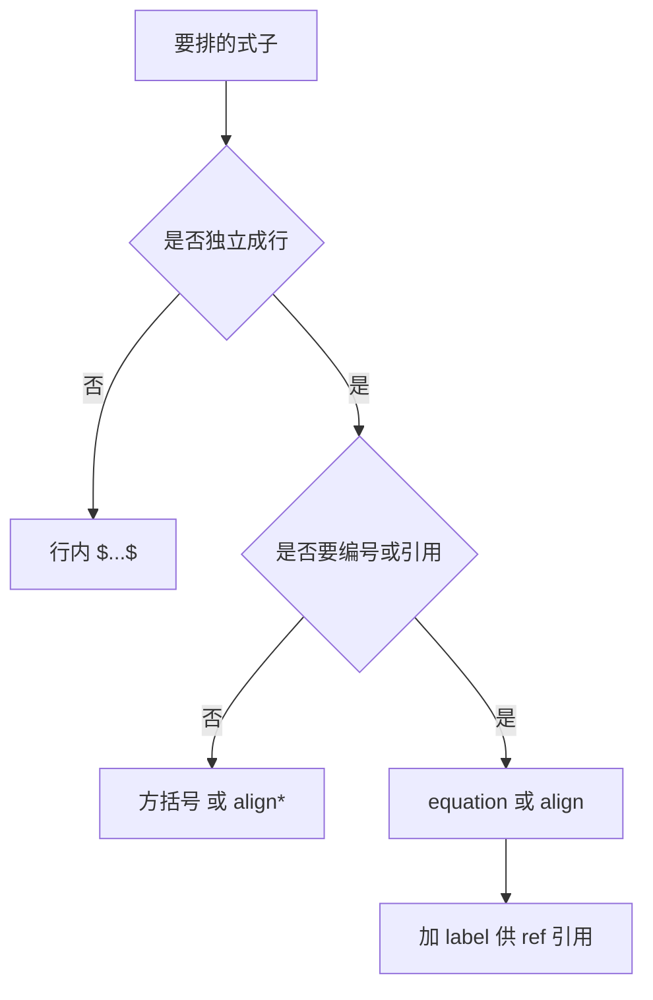

# 第 3 章：数学公式

- **难度**：★★☆ | **预估学时**：3 小时 | **前置**：第 2 章 | **原书定位**：第 4 章 p221–300

## 学习目标

学完本章，你能：

- 正确区分行内公式与行间公式，并按需编号；
- 用 align 排多行推导，用 cases 排分段函数，用 matrix 排矩阵；
- 修掉公式里最常见的四类报错。

## 一句话核心

公式排版只有两个决定：放不放进独立行，给不给编号；其余都是符号命令的查表工作。

## 零基础讲解

### 概念 1：两种模式（难度：基础）

- 行内：`$E=mc^2$`，跟文字一起走，不编号。
- 行间：`\[ E=mc^2 \]`，单独成行，不编号。
- 行间带编号：`\begin{equation} ... \end{equation}`，自动编号，可用 `\label` 引用。

经验规则：短式子、句中提到用行内；需要推导、需要被引用用行间带编号。

### 概念 2：多行推导（难度：进阶）

```latex
\begin{align}
  z &= 4x_1 + 3x_2 \label{eq:obj}\\
  \text{s.t.}\quad & 2x_1 + x_2 \le 10 \\
  & x_1 + x_2 \le 8
\end{align}
```

`&` 是对齐点，`\\` 换行。每个 `&` 都要成对出现，只写一个会导致「Misplaced alignment tab」报错。

不需要编号时用 `align*`。只想给某一行编号，用 `\notag` 把其余行去掉编号。

### 概念 3：常见结构（难度：进阶）

分段函数：

```latex
f(x) = \begin{cases}
  x^2, & x \ge 0,\\
  -x,  & x < 0.
\end{cases}
```

矩阵：

```latex
A = \begin{pmatrix}
  2 & 1 \\
  1 & 1
\end{pmatrix}, \quad
b = \begin{pmatrix} 10 \\ 8 \end{pmatrix}
```

`pmatrix` 用圆括号，`bmatrix` 用方括号，`vmatrix` 用竖线表示行列式。

### 概念 4：四类高频报错（难度：基础）

1. **`&` 位置错**：在 equation 环境里用 `&` 会报错，应该用 align。
2. **下划线未转义**：文本里的 `file_name` 要写成 `file\_name`，公式里才用 `_` 表示下标。
3. **`%` 未转义**：文本里的百分号写成 `\%`，否则后面整行被当注释吞掉。
4. **缺 `$`**：行间公式用了 `\[` 却没写 `\]`，后面全部内容被当成公式。

## 图示



看图说明：两个判断决定环境选择。选错环境，编号或对齐就会出问题。

## 类比与实例

- **类比**：行内公式像句中的括号补充，行间公式像单独列出的算式。失效边界：太长的式子塞进行内，会把行距撑开、版面变丑，这时必须改成行间。
- **实例（可核算）**：把 KKT 条件排成对齐形式：

```latex
\begin{align}
  \nabla f + \sum_{i=1}^{m}\lambda_i \nabla g_i &= 0,\\
  \lambda_i g_i &= 0,\\
  \lambda_i &\ge 0.
\end{align}
```

三行共用一组编号，对齐点在等号前，这是论文里推导的标准写法。

## 常见误解

- 别以为公式里的空格会影响排版——实际上数学模式忽略空格，间距由符号类别决定，要手动调就用 `\,`、`\quad`。
- 别以为 `\text{}` 可以随便用——实际上它需要 amsmath，且中文要放在 `\text{中文}` 里配合 ctex 才正常。
- 别以为编号会自动更新——实际上编号依赖 aux，改完要重编译两遍。

## 自测题（答案与解析）

### Q1 【单选】需要多行对齐并统一编号，应使用？
- A. equation
- B. align
- C. \[ \]
- D. cases
**答案**：B
**解析**：align 提供对齐点与逐行编号，equation 只适合单行公式。

### Q2 【单选】文本中写「准确率 95%」正确的是？
- A. 95%
- B. 95\%
- C. 95$\%$
- D. 95 percent
**答案**：B
**解析**：% 是注释符，必须转义为 \%。

### Q3 【填空】分段函数用________环境，矩阵用 pmatrix 或 bmatrix。
**答案**：cases
**解析**：cases 左侧一个大括号、右侧两列条件，是标准写法。

## 复习锚点

- 行内不编号，行间按需编号，引用要配 label。
- 对齐点 `&` 必须成对，换行用 `\\`。
- % _ # & 在文本里都要转义。
