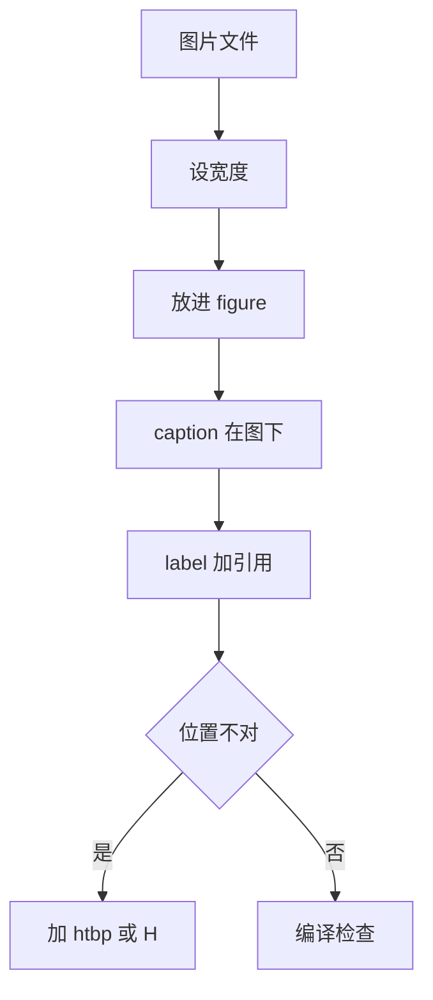

# 第 4 章：图表与浮动体

- **难度**：★★☆ | **预估学时**：3 小时 | **前置**：第 2 章 | **原书定位**：第 5 章插图、第 6 章表格

## 学习目标

学完本章，你能：

- 插入一张宽度合适、图注在图下的图片；
- 用 booktabs 排出规范三线表，并解决列宽溢出；
- 说清 figure 为什么「跑到下一页」，以及怎么控制。

## 一句话核心

图表不是插进去就完事，位置、宽度、图注、正文引用四件事都要交代，缺一件评委会扣格式分。

## 零基础讲解

### 概念 1：插图（难度：基础）

```latex
\usepackage{graphicx}
\begin{figure}[htbp]
  \centering
  \includegraphics[width=0.8\linewidth]{figs/result.png}
  \caption{不同风险水平下的收益曲线}
  \label{fig:risk}
\end{figure}
```

- `[htbp]` 是位置偏好：这里、页顶、页底、单独一页。LaTeX 会就近安排，不保证。
- `width=0.8\linewidth` 按正文宽度比例缩放，比写死厘米更稳。
- `\caption` 放 `\includegraphics` 之后，图注才会在图下方。
- `\label` 放 caption 之后，否则引用会指向错误的编号。

### 概念 2：浮动体为什么乱跑（难度：进阶）

LaTeX 把 figure 当作浮动体，按版面规则排队。图太多、太大、太靠近页底，就会被推到下一页甚至文末。

三个应对：

1. 加 `[htbp]` 给更多选择；
2. 用 `\usepackage{float}` 加 `[H]` 强制在此处；
3. 调整图片宽度，别让一张图高过一页的 70%。

`[H]` 的代价是可能留下大片空白，正式投稿不推荐，课设可以用。

### 概念 3：三线表（难度：基础）

```latex
\usepackage{booktabs}
\begin{table}[htbp]
  \centering
  \caption{三种方案的评价结果}
  \label{tab:score}
  \begin{tabular}{lccc}
    \toprule
    方案 & 成本 & 质量 & 综合得分 \\
    \midrule
    S1 & 0.90 & 0.50 & 0.685 \\
    S2 & 0.70 & 0.80 & 0.685 \\
    S3 & 0.60 & 0.90 & 0.730 \\
    \bottomrule
  \end{tabular}
\end{table}
```

三线表只有顶线、表头线、底线，没有竖线。`lccc` 是列对齐：左对齐一列、居中三列。表格过宽时用 `tabularx` 的 `X` 列自动换行。

### 概念 4：子图（难度：进阶）

```latex
\usepackage{subcaption}
\begin{figure}[htbp]
  \centering
  \begin{subfigure}{0.45\linewidth}
    \includegraphics[width=\linewidth]{a.png}
    \caption{去噪前}
  \end{subfigure}\hfill
  \begin{subfigure}{0.45\linewidth}
    \includegraphics[width=\linewidth]{b.png}
    \caption{去噪后}
  \end{subfigure}
  \caption{均值滤波效果对比}
\end{figure}
```

子图编号变成 (a)、(b)，正文用 `\ref{fig:...}` 引用总编号。两张图之间用 `\hfill` 撑开，别用空格硬凑。

## 图示



看图说明：顺序不能乱，label 一定要在 caption 之后，否则引用编号会错位。

## 类比与实例

- **类比**：浮动体像排队的乘客，LaTeX 是调度员，它按规则安排你上哪班车，不是你说了算。失效边界：调度员可以被 `[H]` 强行插队，但后果是车厢留空。
- **实例（可核算）**：正文宽 15.5 cm，一张 3000×2000 像素的图，按 0.8 倍正文宽插入，显示宽度 12.4 cm、高度 8.27 cm。若按原尺寸插入，宽度 3000 px 直接溢出页面，这是「图跑到页面外」最常见的原因。

## 常见误解

- 别以为写了 `[h]` 就一定在原位——实际上空间不够时 LaTeX 会忽略。
- 别以为表格竖线越多越清楚——实际上三线表最易读，竖线是排版陋习。
- 别以为图片放进同目录就能显示——实际上路径要相对主文件，子目录要写 `figs/a.png`。

## 自测题（答案与解析）

### Q1 【单选】图注要显示在图下方，`\caption` 应放在？
- A. `\includegraphics` 之前
- B. `\includegraphics` 之后
- C. `\label` 之前
- D. figure 环境之外
**答案**：B
**解析**：caption 的位置决定图注上下，放后面才在图下。

### Q2 【单选】三线表需要加载哪个宏包？
- A. graphicx
- B. booktabs
- C. hyperref
- D. listings
**答案**：B
**解析**：booktabs 提供 \toprule、\midrule、\bottomrule。

### Q3 【填空】让图片按正文宽度八成显示，应写 `width=________\linewidth`。
**答案**：0.8
**解析**：用相对宽度而不是绝对厘米，换版式时不用逐张改。

## 复习锚点

- 图注在图下、表注在表上，label 紧跟 caption。
- 宽度用相对值，别超一页七成。
- 表格用三线表，宽了换 tabularx。
