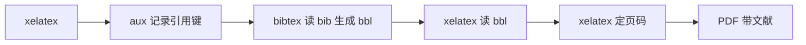

# 第 5 章：目录、交叉引用与参考文献

- **难度**：★★☆ | **预估学时**：3 小时 | **前置**：第 3、4 章 | **原书定位**：第 3 章 p157–219

## 学习目标

学完本章，你能：

- 让目录、图表目录、公式编号全部自动生成；
- 用 label/ref 管理交叉引用，改章节顺序不用手动改编号；
- 用 BibTeX 或 biblatex 生成符合国标的参考文献。

## 一句话核心

自动化的意义只有一个：内容改了，编号自己跟着变；手写的编号迟早会错。

## 零基础讲解

### 概念 1：目录与图表目录（难度：基础）

```latex
\tableofcontents
\listoffigures
\listoftables
```

三者都读 aux 文件，所以要编译两遍。只想让某级标题进目录，用 `\section*{}` 加 `\addcontentsline`，或用 `\setcounter{tocdepth}{2}`。

### 概念 2：交叉引用（难度：基础）

```latex
\section{模型建立}\label{sec:model}
如图~\ref{fig:risk} 所示，第~\ref{sec:model} 节给出了目标函数。
```

- `\ref` 给编号，`\pageref` 给页码，`\eqref` 给带括号的公式编号。
- label 命名建议带前缀：`sec:`、`fig:`、`tab:`、`eq:`，方便搜索。
- 引用前加 `~` 防止「图」和编号被断到两行。

### 概念 3：参考文献（难度：进阶）

传统做法用 BibTeX：

```latex
\usepackage[numbers]{gbt7714}   % 国标顺序编码制
\bibliographystyle{gbt7714-numerical}
\bibliography{refs}
```

`refs.bib` 里每条记录：

```bibtex
@article{si2020,
  author  = {司守奎 and 孙玺菁},
  title   = {数学建模算法与应用},
  journal = {国防工业出版社},
  year    = {2020},
  pages   = {1--17}
}
```

正文用 `\cite{si2020}` 引用，编译链变成：xelatex → bibtex → xelatex → xelatex。

用 biblatex 的话加载 `\usepackage[backend=biber,style=numeric]{biblatex}`，编译用 biber。

### 概念 4：引用不出现的排查（难度：进阶）

按顺序查四件事：

1. `.bib` 文件路径对不对；
2. `\cite` 的 key 与 bib 里是否完全一致（大小写敏感）；
3. 有没有跑 bibtex（只跑 xelatex 不会生成文献列表）；
4. `.bbl` 文件是否生成，报错日志里搜 `I couldn't open database`。

## 图示



看图说明：四步是一条链，少一步文献就显示 `[?]`。latexmk 会自动跑完整条链，所以推荐用它。

## 类比与实例

- **类比**：交叉引用像 Excel 的单元格引用，改一处全表更新；手写编号像手抄公式，改一次要抄十处。失效边界：Excel 引用错了会报 `#REF!`，LaTeX 引用错了只显示 `??`，不一定会提醒你。
- **实例（可核算）**：论文有 6 章、18 图、9 表，手写编号在插入一章后需要改 30 多处；用 label/ref 只需重编译两遍。

## 常见误解

- 别以为 `\ref` 会自动带「图」字——实际上只输出编号，前缀要自己写。
- 别以为 bib 里的条目顺序影响输出——实际上顺序由样式决定，与文件顺序无关。
- 别以为中文文献不用管格式——实际上国标要求作者、题名、文献类型标识齐全，gbt7714 样式帮你补齐。

## 自测题（答案与解析）

### Q1 【单选】`\ref{fig:risk}` 输出的是什么？
- A. 图的文件名
- B. 图的编号
- C. 图的标题
- D. 图的页码
**答案**：B
**解析**：ref 输出编号，页码用 pageref，标题不会被引用。

### Q2 【单选】文献列表显示 `[?]`，最先检查？
- A. 图片路径
- B. 是否跑了 bibtex、cite key 是否匹配
- C. 字号设置
- D. 页边距
**答案**：B
**解析**：`[?]` 表示引用键找不到对应条目，先查编译链与 key。

### Q3 【填空】国标顺序编码制的宏包是________。
**答案**：gbt7714
**解析**：gbt7714 提供符合 GB/T 7714 的样式，配合 BibTeX 或 biblatex 使用。

## 复习锚点

- 目录、图表目录都靠 aux，编译至少两遍。
- label 带前缀，ref 前加 `~`。
- 文献链：xelatex → bibtex → xelatex → xelatex。
