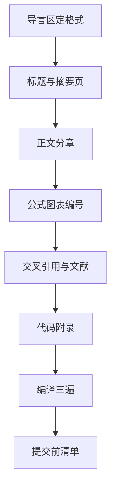

# 第 6 章：数模论文模板实战

- **难度**：★★☆ | **预估学时**：3 小时 | **前置**：第 1–5 章 | **原书定位**：综合第 2–6 章

## 学习目标

学完本章，你能：

- 用一份导言区搭出可直接写正文的论文骨架；
- 排出三层以上、编号连续的标题体系，并把「：」后的分论点也编号；
- 用 listings 排代码附录，交卷前按清单查出格式硬伤。

## 一句话核心

模板的价值不在好看，在于它把「格式」这件事一次性定死，让你后面只操心内容。

## 零基础讲解

### 概念 1：可直接复制的导言区（难度：基础）

```latex
\documentclass[UTF8,a4paper,zihao=-4]{ctexart}
\usepackage{amsmath,amssymb,amsthm}
\usepackage{graphicx,booktabs,tabularx}
\usepackage{geometry}
\geometry{top=2.5cm,bottom=2.5cm,left=3cm,right=2.5cm}
\usepackage{fancyhdr}
\usepackage{caption}
\captionsetup{font=small,labelsep=quad}
\usepackage[numbers]{gbt7714}
\usepackage{listings}
\usepackage[hidelinks]{hyperref}

\linespread{1.3}
\setcounter{secnumdepth}{4}
\setcounter{tocdepth}{3}

\pagestyle{fancy}
\fancyhf{}
\fancyhead[C]{2026 年全国大学生数学建模竞赛}
\fancyfoot[C]{\thepage}
\renewcommand{\headrulewidth}{0.4pt}

\newtheorem{definition}{定义}[section]
\newtheorem{theorem}{定理}[section]

\lstset{
  basicstyle=\ttfamily\small,
  numbers=left,
  numberstyle=\tiny,
  frame=single,
  breaklines=true,
  showstringspaces=false
}
```

这段直接贴到新建的 `main.tex` 里，下面接 `\begin{document}` 就能写。

### 概念 2：标题编号体系（难度：进阶）

竞赛论文常见要求：一级标题用「一、二、三」，二级用「3.1」，三级用「3.1.2」，四级用「6.3.2.1」。

```latex
\ctexset{
  section = {
    name = {,、},
    number = \chinese{section},
    format = \Large\bfseries
  },
  subsection = {number = \arabic{section}.\arabic{subsection}},
  subsubsection = {number = \arabic{section}.\arabic{subsection}.\arabic{subsubsection}}
}
```

要更深的层级（如 6.3.2.1），必须把 `secnumdepth` 设为 4 或 5，否则 `\paragraph` 只有标题没有编号。

正文里「：」后面跟的分论点也要编号时，别用无序列表，直接排成带编号的段落：

```latex
\noindent （1）模型假设：\\
\indent （1.1）原材料价格在三个月内不变；\\
\indent （1.2）机器每天最多运行 8 小时。
```

或者定义一个计数器命令，避免手写编号错乱：

```latex
\newcounter{subpoint}[subsection]
\newcommand{\pt}[1]{\stepcounter{subpoint}\noindent（\thesubsection.\thesubpoint）~#1\par}
```

### 概念 3：摘要页（难度：基础）

```latex
\begin{center}
  {\LARGE\bfseries 基于线性规划与灵敏度分析的机床生产优化}\\[6pt]
  {\large 摘\quad 要}
\end{center}
\vspace{6pt}
本文针对……建立……模型，求得最优方案为……，日利润 2.6 万元。
第三问用 Monte Carlo 模拟 10 万次，得期望利润 2.41 万元，90\% 置信区间 [2.05, 2.77]。
\vspace{6pt}\par\noindent\textbf{关键词：}线性规划；灵敏度分析；Monte Carlo
\newpage
```

摘要独立一页，不编页码或用罗马数字，正文从第一页重新编号。

### 概念 4：代码附录（难度：基础）

```latex
\appendix
\section{程序代码}
\begin{lstlisting}[language=Python]
import numpy as np
from scipy.optimize import linprog
res = linprog([-4, -3], A_ub=[[2, 1], [1, 1], [0, 1]],
              b_ub=[10, 8, 7], bounds=[(0, None), (0, None)],
              method="highs")
print(res.x, -res.fun)
\end{lstlisting}
```

中文注释在 listings 里可能乱码，需要设 `extendedchars=true` 或改用 `\lstinputlisting` 读外部文件。

## 图示



看图说明：格式在第一步定死，后面每一步都依赖它。中途改导言区，整篇的编号与分页都要重查。

## 类比与实例

- **类比**：模板像盖房子的图纸，先定层高与承重，后面砌墙才有依据。失效边界：图纸能改，但改完要重新验收；模板改字号，全文页数会变，摘要可能挤到第二页。
- **实例（可核算）**：正文小四、1.3 倍行距，A4 纸每页约 32 行、每行 36 字，一页约 1150 字。20 页正文约 2.3 万字，加图表与公式实际约 1.8 万字。字数估算能帮你判断内容够不够。

## 常见误解

- 别以为套模板就能拿格式分——实际上模板只保证不扣分，图表规范、编号连续仍要自己查。
- 别以为改字号只影响美观——实际上它改变每页容量，进而影响页数与摘要位置。
- 别以为代码附录可以随便截——实际上变量名要与正文一致，否则评委会怀疑结果来源。

## 自测题（答案与解析）

### Q1 【单选】要让四级标题带编号，除设置 number 外还必须？
- A. 改 tocdepth
- B. 把 secnumdepth 调到 4 以上
- C. 加载 hyperref
- D. 用 appendix
**答案**：B
**解析**：编号深度由 secnumdepth 控制，默认只到 3 级。

### Q2 【单选】摘要页后的正文要重新从第 1 页编号，应该？
- A. 直接 \setcounter{page}{1}
- B. 用 \pagenumbering{arabic} 重置
- C. 改 fancyhdr
- D. 重新编译
**答案**：B
**解析**：pagenumbering 会重置页码计数器，setcounter 只改数值不重置样式。

### Q3 【填空】代码附录应使用________环境，配合 listings 宏包。
**答案**：lstlisting
**解析**：lstlisting 支持语法高亮、行号、自动换行，是排代码的标准环境。

## 复习锚点

- 导言区一次性定死字号、边距、编号深度。
- 「一、」与「3.1.2」混排靠 ctexset 的 number 参数。
- 交卷前查：编号连续、图表有注、文献不缺、PDF 无溢出。
