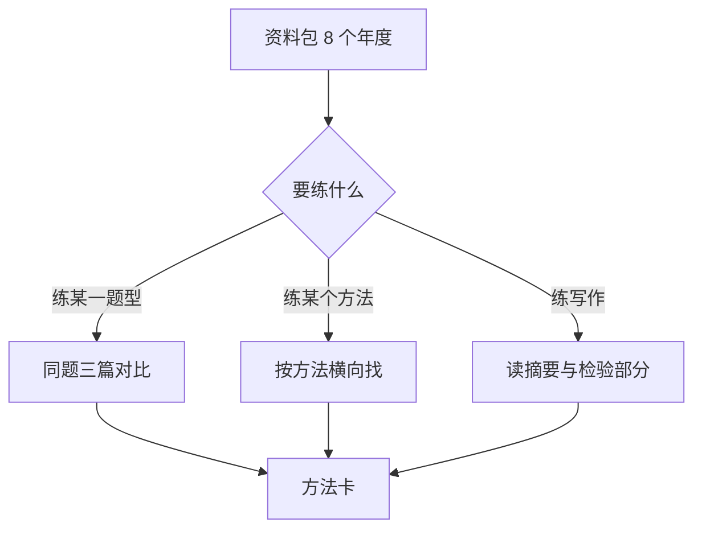

# 第 2 章：2016–2023 论文地图

- **难度**：★☆☆ | **预估学时**：1 小时 | **前置**：第 1 章

## 学习目标

学完本章，你能：

- 说清手头这份资料包里每年有多少篇、覆盖哪些题；
- 按「同题多篇对比」的方式挑出该读的几篇；
- 知道哪几年的资料不完整，别白找。

## 一句话核心

读论文的正确顺序不是从 2016 读到 2023，而是同一道题读三篇，看不同队怎么拆同一个问题。

## 资料包实际内容

压缩包 `2016-2023年——全国大学生数学建模竞赛优秀论文.rar` 共 767 个条目，按年份分 8 个目录。实际可用论文数量如下（按文件名统计）：

| 年份 | 论文份数 | 覆盖题号 | 说明 |
|---|---|---|---|
| 2016 | 23 份 PDF | A、B、C、D | 含 4 份赛题讲评 |
| 2017 | 33 份 PDF | A、B 为主，另有综合展示 | 含赛题评析 |
| 2018 | 19 份 PDF | A、B、C、D | A 题 9 篇，最全 |
| 2019 | 4 篇（扫描图） | A、B、C、D、E | 每篇为多张 JPG，需拼页阅读 |
| 2020 | 3 份 PDF | A、B | 仅 3 篇，明显不全 |
| 2021 | 34 份 PDF | A、B、C、D、E | 五题齐全，最完整的一年 |
| 2022 | 9 份 PDF | A、B、C | 数量中等 |
| 2023 | 13 份 PDF | A、B、C、D、E | 五题都有 |

两点必须知道：

- **2019 是图片**，不是 PDF。要读得先把每篇的 JPG 按序号拼起来，或者用 OCR 工具转文字。
- **2020 只有 3 篇**，别以为是自己解压失败。

## 挑选策略

### 概念 1：同题三篇（难度：基础）

选一道你熟悉的题，找同题的三篇论文，分别读摘要与模型结构，比较：

- 变量定义是否一致；
- 假设差在哪；
- 一个用规划、一个用启发式时，各自怎么解释选择。

三篇读完，你会发现自己对这道题的理解比对十道不同的题更深。

### 概念 2：按方法找（难度：进阶）

如果你正在练某个方法（比如第 14 章的综合评价），去索引里找用了这个方法的所有论文，横向比较它们怎么处理权重、怎么做灵敏度。这比读教材例题更接近实战。

## 图示

看图说明：三条路都落到方法卡。不要为了「读完」而读，为了「用上」而读。

## 类比与实例

- **类比**：这份资料包像一间旧书店，2021 那排最齐，2020 那排缺了好几本。先看清库存再借书，比一本本翻快。失效边界：书店能补齐，这份包补不齐，缺的年份只能另找。
- **实例（可核算）**：2021 年五题共 34 篇，平均每题约 7 篇。按每题读 3 篇算，读完五题需 15 篇，约 10 小时（每篇 40 分钟）。这是可执行的计划，而不是「把 34 篇都读完」。

## 常见误解

- 别以为份数多的年份质量就高——实际上论文是择优展示，份数反映的是收录力度。
- 别以为扫描件不能读——实际上拼页后完全可读，只是费时间。
- 别以为读得越多越好——实际上同题三篇的收获大于十道不同的题各读一篇。

## 自测题（答案与解析）

### Q1 【单选】资料包中五题最齐全的年份是？
- A. 2018
- B. 2019
- C. 2021
- D. 2023
**答案**：C
**解析**：2021 年 34 份，A 到 E 五题都有，且为 PDF。

### Q2 【单选】2019 年论文的格式是？
- A. PDF
- B. 每篇多张 JPG
- C. Word
- D. 网页
**答案**：B
**解析**：按序号排列的扫描图，需要拼页阅读。

### Q3 【填空】推荐的读法是同一道题读________篇，比较不同队的拆法。
**答案**：三
**解析**：同题对比能暴露假设与方法的差异，比泛读有效。

## 复习锚点

- 2021 最全、2020 最缺、2019 是图片。
- 同题三篇优于十题各一篇。
- 按方法横向找，练什么找什么。
