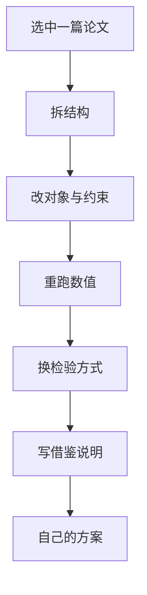

# 第 3 章：从案例到自己的方案

- **难度**：★★☆ | **预估学时**：2 小时 | **前置**：第 1、2 章

## 学习目标

学完本章，你能：

- 把一篇论文的方法改造成适合自己题目的版本；
- 判断哪些部分可以直接抄结构、哪些必须重做；
- 写出「借鉴说明」，避免被判定为抄袭。

## 一句话核心

案例能借的是结构和流程，不能借的是数据与结论；改一个参数就当成自己的结果，是竞赛里最危险的动作。

## 零基础讲解

### 概念 1：三层可借度（难度：基础）

| 层级 | 能借什么 | 处理方式 |
|---|---|---|
| 结构层 | 章节顺序、图表类型、检验方式 | 直接照搬，注明参考 |
| 方法层 | 模型框架、算法流程 | 改参数、改约束，重跑 |
| 数据层 | 具体数值、结论 | 一律不能借，必须自己算 |

结构层借用不算抄袭，方法层要说明改动，数据层照抄就是学术不端。

### 概念 2：改造四步（难度：进阶）

1. **换对象**：把论文里的「某工厂」换成你的题里的对象，检查量纲与量级是否还成立。
2. **换约束**：新题往往多一两条限制，加进去后重解，看结论怎么变。
3. **换检验**：论文做的是参数灵敏度，你的题可能需要误差分析或与基准方法对比。
4. **换表述**：结论要用你自己的数据说话，不能保留原文的数字。

### 概念 3：借鉴说明怎么写（难度：基础）

在参考文献或脚注写清：

```text
本文模型框架参考了 2021 年 A 题某队的分层求解思路，将原模型的两阶段改为三阶段，
增加了约束 …, 全部数值结果由本文程序重新计算。
```

一句话交代来源与改动，比藏着不说安全得多。

### 概念 4：把论文变成代码（难度：进阶）

论文给的是公式，代码要自己写。顺序：

1. 先用小数据手算一遍，确认公式能对上论文里的数字；
2. 写成脚本，跑同一组小数据，对比结果；
3. 换成自己的数据，检查量级是否合理；
4. 保存中间结果，论文里的每个数字都要能追到一个输出文件。

## 图示



看图说明：注意「重跑数值」在改完约束之后，顺序颠倒就会把旧结论带进新题。

## 类比与实例

- **类比**：借论文像借菜谱，步骤可以照做，食材必须换成你家的。失效边界：菜谱换了食材味道会变，模型换了数据结论可能完全反过来，所以必须重算而不是微调。
- **实例（可核算）**：某论文的线性规划最优解是 (2, 6)、利润 26。你若把乙产品利润从 3 改成 5，最优解变成 (1, 7)、利润 39，与原文完全不同。直接沿用 26，评委会立刻发现数字对不上你的模型。

## 常见误解

- 别以为改几个字就不算抄——实际上模型、数据、结论三处任一重合都可能被查。
- 别以为方法一样就没有创新——实际上在新约束下重新求解、给出新的灵敏度，本身就是工作。
- 别以为引用越少越显得独立——实际上该引不引，反而显得你不知道来源。

## 自测题（答案与解析）

### Q1 【单选】三层可借度中，哪一层完全不能借？
- A. 结构层
- B. 方法层
- C. 数据层
- D. 图表类型
**答案**：C
**解析**：具体数值与结论必须自己算，照抄属于学术不端。

### Q2 【单选】改造四步的正确顺序是？
- A. 换表述 → 换对象 → 换约束 → 换检验
- B. 换对象 → 换约束 → 换检验 → 换表述
- C. 换检验 → 换表述 → 换对象 → 换约束
- D. 任意顺序
**答案**：B
**解析**：先把对象与约束改对，再重跑与检验，最后才是表述。

### Q3 【填空】借鉴他人模型框架时，应在文中写清来源与________。
**答案**：改动
**解析**：交代改了什么，读者才能判断你的贡献在哪。

## 复习锚点

- 结构可借、方法要改、数据必重算。
- 改造顺序：对象、约束、检验、表述。
- 借鉴说明一句话：来源 + 改动 + 全部重算。
